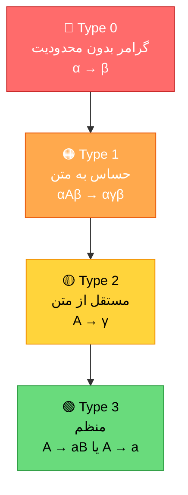
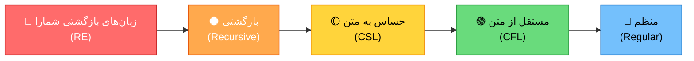

# 📘 جزوه خلاصه: نظریه زبان‌ها و ماشین‌ها

> [!info] منبع
> فصل مفاهیم پایه — مناسب مرور سریع کنکور

---

## 1️⃣ مقدمه

> [!note] تعریف
> **نظریه زبان‌ها**: مطالعه‌ی مدل‌های ریاضی برای توصیف و تحلیل زبان‌ها (به‌ویژه زبان‌های برنامه‌سازی و محاسباتی).

سه رکن اصلی:

| رکن | توضیح |
|---|---|
| 🗣️ **زبان (Language)** | مجموعه‌ای از رشته‌ها |
| 📜 **گرامر (Grammar)** | قواعد تولید رشته‌ها |
| ⚙️ **ماشین (Automata)** | مدل تشخیص/پذیرش زبان |

🎯 **هدف:** دسته‌بندی زبان‌ها بر اساس قدرت توصیف‌پذیری.

---

## 2️⃣ نظریه مجموعه‌ها

### 2-1) مجموعه‌ها

> [!abstract] نمادها
> عضویت $\in$ ، زیرمجموعه $\subseteq$ ، زیرمجموعه سره $\subset$ ، مجموعه تهی $\emptyset$ یا $\{\}$

> [!tip] فرمول‌های کلیدی
> 
> | مفهوم | فرمول |
> |---|---|
> | تعداد زیرمجموعه‌های یک مجموعه $n$ عضوی | $2^n$ |
> | تعداد زیرمجموعه‌های سره (بدون خود مجموعه) | $2^n - 1$ |
> | تعداد زیرمجموعه‌های ناتهی | $2^n - 1$ |
> | تعداد زیرمجموعه‌های سره ناتهی | $2^n - 2$ |
> | مجموعه توانی | $\|P(A)\| = 2^{\|A\|}$ |

- **اصل ضرب دکارتی:** $|A \times B| = |A| \cdot |B|$
- $A \times B \neq B \times A$ (مگر حالات خاص)

> [!warning] نکته تستی
> اگر $A \subseteq B$ آنگاه $P(A) \subseteq P(B)$ — اما **عکسش لزوماً برقرار نیست**.

---

### 2-2) رابطه

> [!note] تعریف
> **رابطه دوتایی** روی $A$: زیرمجموعه‌ای از $A \times A$.
> 
> **ضرب دکارتی:** $A \times B = \{(a,b) \mid a \in A,\ b \in B\}$

**انواع رابطه (خواص):**

| خاصیت | شرط | مثال |
|---|---|---|
| 🔄 **بازتابی (Reflexive)** | $\forall a \in A:\ $a,a$ \in R$ | $\leq$ روی اعداد |
| ↔️ **تقارنی (Symmetric)** | $(a,b) \in R \Rightarrow $b,a$ \in R$ | $=$ |
| 🔗 **تعدی (Transitive)** | $(a,b),(b,c) \in R \Rightarrow $a,c$ \in R$ | $\leq$ |

> [!success] رابطه هم‌ارزی (Equivalence)
> رابطه‌ای که **بازتابی + تقارنی + تعدی** باشد.
> 
> 🔹 مثال: هم‌نهشتی (congruence) modulo $n$.
> 
> 🔹 **رابطه ترتیب جزئی (Partial Order):** بازتابی + پادتقارنی + تعدی.

> [!tip] نکته تستی
> رابطه هم‌ارزی → **افراز (partition)** روی مجموعه ایجاد می‌کند و بالعکس.

---

### 2-3) تابع

> [!note] تعریف
> **تابع** $f: A \to B$: رابطه‌ای که به هر عضو $A$ **دقیقاً یک** عضو از $B$ نسبت می‌دهد.

| نوع تابع | شرط |
|---|---|
| 🎯 **یک‌به‌یک (Injective)** | $f(a_1)=f(a_2) \Rightarrow a_1=a_2$ |
| 📤 **پوشا (Surjective)** | $\forall b \in B,\ \exists a \in A:\ f(a)=b$ |
| 🔁 **دوسویی (Bijective)** | یک‌به‌یک و پوشا با هم |
| ⚠️ **جزئی (Partial)** | روی زیرمجموعه‌ای از دامنه تعریف شده |
| ✅ **کامل (Total)** | روی تمام دامنه تعریف شده |

> [!warning] نکته
> **تابع معکوس** فقط برای توابع **دوسویی** وجود دارد.

---

## 3️⃣ روش‌های اثبات

| روش | ایده کلی |
|---|---|
| 🏗️ **اثبات از طریق ساخت** | یافتن مثال یا نمونه‌ای که حکم را برآورده کند |
| 💥 **برهان خلف** | فرض نقیض حکم → رسیدن به تناقض |
| 📈 **استقرا** | پایه + فرض استقرا + گام استقرا |

> [!abstract] استقرای ریاضی (شکل استاندارد)
> 1. **پایه:** درستی برای $n = n_0$
> 2. **فرض:** درستی برای $n = k$
> 3. **گام:** اثبات برای $n = k+1$

> [!info] استقرای قوی
> فرض درستی برای **همه‌ی مقادیر** $\leq k$.

> [!tip] نکته تستی
> در اثبات‌های نظریه زبان، استقرا روی **طول رشته ($|w|$)** بسیار رایج است.

---

## 4️⃣ زبان و مفاهیم پایه

### 4-1) الفبا و رشته

> [!note] تعریف‌ها
> - **الفبا $$\Sigma$$**: مجموعه‌ای متناهی و ناتهی از نمادها.
> - **رشته (String)**: دنباله‌ای متناهی از نمادهای $\Sigma$.
> - **رشته تهی $$\lambda$$ or $$\varepsilon$$**: رشته‌ای با طول صفر.

| مفهوم | تعریف |
|---|---|
| **طول رشته** $\|w\|$ | تعداد نمادهای رشته |
| **الحاق (Concatenation)** | $w \cdot v$ یا $wv$ |
| **معکوس** $w^R$ | رشته‌ی وارونه |
| **توان** $w^n$ | $n$ بار الحاق $w$ به خودش |
| **پیشوند (Prefix)** | $u$ که $w = uv$ |
| **پسوند (Suffix)** | $v$ که $w = uv$ |
| **زیررشته (Substring)** | بخش پیوسته‌ای از $w$ |

> [!important] نکات مهم
> - رشته $\lambda$ پیشوند و پسوند **هر رشته** است.
> - تعداد پیشوندهای **متمایز** یک رشته به طول $n$: حداکثر **$n+1$**
> - $|w^R| = |w|$ و $(w^R)^R = w$
> - $(uv)^R = v^R u^R$

> [!danger] تفاوت $\lambda$ و $\emptyset$
> - $\lambda$ یک **رشته** (با طول صفر) است.
> - $\emptyset$ یک **مجموعه/زبان** (بدون هیچ رشته) است.
> - $\{\lambda\} \neq \emptyset$ — اولی مجموعه‌ای شامل رشته تهی، دومی مجموعه خالی!

---

### 4-2) عملگرها روی رشته

**بستار ستاره‌ای (Kleene Star)** روی $\Sigma$:

$$\Sigma^* = \Sigma^0 \cup \Sigma^1 \cup \Sigma^2 \cup \cdots$$

**بستار مثبت:**

$$\Sigma^+ = \Sigma^* - \{\lambda\} = \Sigma^1 \cup \Sigma^2 \cup \cdots$$

> [!warning] نکته
> $\lambda \in \Sigma^*$ همیشه، ولی $\lambda \in \Sigma^+$ **هرگز** (مگر تعریف خاص).

---

### 4-3) زبان

> [!note] تعریف
> **زبان $L$**: مجموعه‌ای از رشته‌ها روی الفبای $\Sigma$، یعنی $L \subseteq \Sigma^*$.

**انواع زبان:**

| نوع | توضیح |
|---|---|
| 📦 **متناهی (Finite)** | تعداد محدودی رشته دارد |
| ♾️ **نامتناهی (Infinite)** | تعداد نامحدودی رشته دارد |
| 🚫 زبان **تهی** | $L = \emptyset$ |

> [!tip] نکته
> $\emptyset$، $\{\lambda\}$ و $\Sigma^*$ همیشه زبان هستند.

---

### 4-4) عملگرها روی زبان

فرض کنید $L_1, L_2 \subseteq \Sigma^*$.

| عملگر | تعریف |
|---|---|
| **اجتماع** | $L_1 \cup L_2$ |
| **اشتراک** | $L_1 \cap L_2$ |
| **تفاضل** | $L_1 - L_2$ |
| **متمم** | $\overline{L} = \Sigma^* - L$ |
| **الحاق** | $L_1 L_2 = \{xy \mid x \in L_1,\ y \in L_2\}$ |
| **معکوس** | $L^R = \{w^R \mid w \in L\}$ |
| **توان** | $L^n = \underbrace{L \cdot L \cdots L}_{n}$ |
| **بستار ستاره** | $L^* = L^0 \cup L^1 \cup L^2 \cup \cdots$ |
| **بستار مثبت** | $L^+ = L^1 \cup L^2 \cup \cdots = L \cdot L^* = L^* \cdot L$ |

> [!important] نکات کلیدی الحاق زبان
> - الحاق **جابه‌جایی ندارد**: $L_1 L_2 \neq L_2 L_1$ (به‌طور کلی)
> - اگر $|L_1|$ و $|L_2|$ متناهی باشند:
> 
> $$|L_1 L_2| \leq |L_1| \cdot |L_2|$$
> 
>   $علامت $\leq$ چون ممکن است رشته‌های یکسان تولید شوند$
> - $L \emptyset = \emptyset L = \emptyset$
> - $L \{\lambda\} = \{\lambda\} L = L$
> - $(L_1 L_2)^R = L_2^R L_1^R$
> - $\overline{L_1 L_2} \neq \overline{L_1} \cdot \overline{L_2}$ (دقت!)

**نکات مربوط به $L^*$:**

| مورد | نتیجه |
|---|---|
| $\emptyset^*$ | $\{\lambda\}$ ⚠️ |
| $\{\lambda\}^*$ | $\{\lambda\}$ |
| $\Sigma^*$ | تمام رشته‌های ممکن |
| $L^+ = L^*$ | اگر و تنها اگر $\lambda \in L$ |
| $\lambda \in L^*$ | همیشه درست است |
| $\lambda \in L^+$ | فقط اگر $\lambda \in L$ |

> [!danger] تریک طلایی کنکور
> $\emptyset^* = \{\lambda\}$ — این یکی از پرتکرارترین دام‌های تستی است!
> 
> $(L^*)^* = L^*$ و $(L^+)^+ = L^+$

---

## 5️⃣ گرامرها

### 5-1) تعریف گرامر

> [!note] تعریف
> گرامر $G$ یک چهارتایی است:
> 
> $$G = (V,\ T,\ P,\ S)$$

| نماد | توضیح |
|---|---|
| $V$ | مجموعه متناهی **متغیرها (Non-terminals)** |
| $T$ | مجموعه متناهی **پایانه‌ها (Terminals)**، $V \cap T = \emptyset$ |
| $P$ | مجموعه **قواعد تولید (Productions)** به شکل $\alpha \to \beta$ |
| $S \in V$ | **نماد شروع (Start Symbol)** |

**زبان تولیدشده توسط گرامر:**

$$L(G) = \{w \in T^* \mid S \Rightarrow^* w\}$$

---

### 5-2) انواع گرامرها (سلسله‌مراتب چامسکی)



| نوع | نام | محدودیت قاعده | زبان | ماشین |
|---|---|---|---|---|
| **Type 0** | بدون محدودیت | $\alpha \to \beta$ | بازگشتی شمارا | ماشین تورینگ |
| **Type 1** | حساس به متن $CSG$ | $\|\alpha\| \leq \|\beta\|$ $به‌جز $S \to \lambda$$ | حساس به متن | LBA |
| **Type 2** | مستقل از متن $CFG$ | $A \to \gamma$ که $A \in V$ | مستقل از متن | پشته‌ای $PDA$ |
| **Type 3** | منظم $RG$ | $A \to aB$ یا $A \to a$ | منظم | متناهی (DFA/NFA) |

> [!tip] نکته
> $$\text{Regular} \subset \text{CFL} \subset \text{CSL} \subset \text{REC} \subset \text{RE}$$

---

### 5-3) سلسله‌مراتب زبان‌ها



> [!info] تعاریف
> - **زبان بازگشتی (Recursive):** هم خودش و هم متممش بازگشتی شمارا هستند.
> - **زبان RE:** توسط ماشین تورینگ پذیرفته می‌شود (ممکن است متوقف نشود).
> - زبان منظم همیشه بازگشتی است.

---

## 6️⃣ ماشین‌ها

| ماشین | حافظه | قدرت |
|---|---|---|
| 🔵 **DFA/NFA** | هیچ (حالت متناهی) | زبان منظم |
| 🟢 **PDA** | پشته (Stack) | زبان مستقل از متن |
| 🟡 **LBA** | نوار کراندار | زبان حساس به متن |
| 🔴 **TM** | نوار نامحدود | زبان RE |

**تعاریف رسمی:**

$$DFA = (Q, \Sigma, \delta, q_0, F), \quad \delta: Q \times \Sigma \to Q$$

$$NFA = (Q, \Sigma, \delta, q_0, F), \quad \delta: Q \times \Sigma \to 2^Q$$

$$PDA = (Q, \Sigma, \Gamma, \delta, q_0, Z_0, F)$$

$$TM = (Q, \Sigma, \Gamma, \delta, q_0, q_{accept}, q_{reject})$$

> [!tip] نکته تستی
> DFA و NFA قدرت **یکسان** دارند؛ هر NFA را می‌توان به DFA تبدیل کرد (اثبات از طریق ساخت).

---

## 🎯 جمع‌بندی نهایی و نکات طلایی

> [!success] ۸ نکته طلایی کنکور
> 1. $2^n$ زیرمجموعه، $2^n - 2$ زیرمجموعه سره ناتهی.
> 2. رابطه هم‌ارزی = بازتابی + تقارنی + تعدی.
> 3. رشته تهی $\lambda \neq \emptyset$؛ ولی $\emptyset^* = \{\lambda\}$.
> 4. الحاق زبان جابه‌جایی ندارد؛ $|L_1L_2| \leq |L_1| \cdot |L_2|$.
> 5. $L^+ = L^*$ اگر و تنها اگر $\lambda \in L$.
> 6. سلسله‌مراتب: منظم ⊂ مستقل از متن ⊂ حساس به متن ⊂ بازگشتی ⊂ RE.
> 7. هر زبان متناهی، **منظم** است.
> 8. $L^*$ همیشه $\lambda$ دارد؛ $L^+$ فقط وقتی $\lambda \in L$.

---

> [!quote] 🗺️ نقشه ذهنی کلی
> ```mermaid
> mindmap
>   root((نظریه زبان‌ها))
>     مفاهیم پایه
>       مجموعه‌ها
>       روابط
>       توابع
>     زبان
>       الفبا
>       رشته
>       عملگرها
>     <font color="#4bacc6">گرامر</font>
>       Type 0
>       Type 1
>       Type 2
>       Type 3
>     ماشین
>       DFA/NFA
>       PDA
>       LBA
>       TM
> ```


