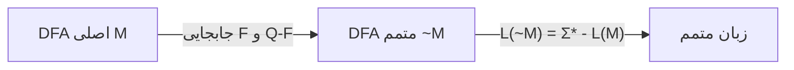
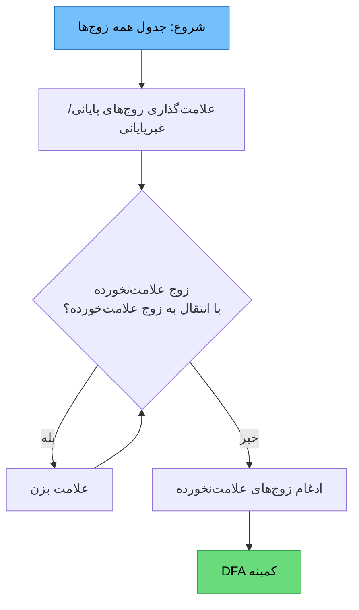
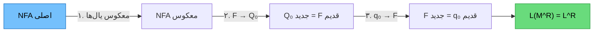
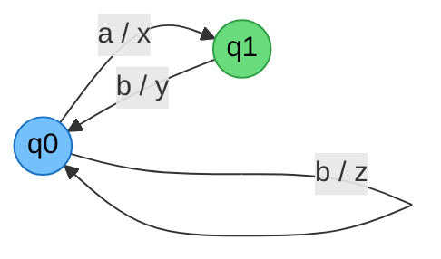
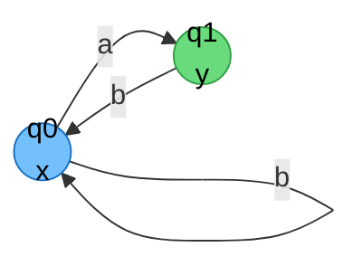

# 📘 جزوه فصل ۲: ماشین‌های متناهی

> [!info] منبع
> فصل ماشین‌های متناهی — DFA، NFA، کاهش حالت و ماشین‌های با خروجی

---

## 1️⃣ ماشین‌های متناهی قطعی (DFA)

### 1-1) تعریف DFA

> [!note] تعریف رسمی
> یک DFA یک پنج‌تایی است:
> 
> $$M = (Q,\ \Sigma,\ \delta,\ q_0,\ F)$$

| نماد | توضیح |
|---|---|
| $Q$ | مجموعه متناهی حالات |
| $\Sigma$ | الفبای ورودی |
| $\delta$ | تابع انتقال: $\delta: Q \times \Sigma \to Q$ |
| $q_0 \in Q$ | حالت شروع |
| $F \subseteq Q$ | مجموعه حالات پایانی |

> [!abstract] تابع انتقال توسعه‌یافته $\delta^*$
> $$\delta^*: Q \times \Sigma^* \to Q$$
> 
> - $\delta^*(q, \lambda) = q$
> - $\delta^*(q, wa) = \delta(\delta^*(q, w), a)$

**زبان پذیرفته‌شده:**
$$L(M) = \{w \in \Sigma^* \mid \delta^*(q_0, w) \in F\}$$

> [!tip] نکته
> مرتبه زمانی تشخیص تعلق رشته $w$ با $|w| = n$ به یک DFA برابر **$O(n)$** است.

---

### 1-2) متمم زبان و DFA

> [!warning] دقت مهم
> اگر $M_1$ یک ماشین متناهی باشد، **لزوماً** $\overline{L(M_1)} \neq L(\sim M_1)$
> 
> برای ساخت متمم باید بنویسیم:
> $$\overline{L(M_1)} = L(\sim \delta(M_1))$$

**روش متمم کردن DFA:**

> [!success] مراحل متمم کردن DFA
> 1. تمام حالات **غیرپایانی** را به **پایانی** تبدیل کن.
> 2. تمام حالات **پایانی** را به **غیرپایانی** تبدیل کن.
> 3. ساختار ماشین تغییر نمی‌کند.



> [!important] روابط متممی
> - اگر $L$ منظم باشد، $\overline{L}$ هم **منظم** است.
> - $\overline{\overline{L}} = L$
> - ماشین متمم، همان DFA با $F' = Q - F$

---

### 1-3) نکات کلیدی DFA

> [!danger] نکات طلایی کنکور
> 
> **۱) نامتناهی بودن زبان:**
> اگر DFA با $n$ حالت، رشته‌ای به طول بیشتر از n-1 را بپذیرد انگاه زبان **لزوماً نامتناهی** است.
> 
> **۲) پذیرش رشته کوتاه‌تر:**
> اگر همان ماشین رشته‌ای به طول n یا بیشتر بپذیرد، لزوماً رشته‌ای به طول **کوچک‌تر** هم می‌پذیرد.
> 
> **۳) یکتایی:**
> - DFA یک زبان **منحصر به فرد نیست** (چند DFA می‌توانند یک زبان را بپذیرند).
> - اما **زبان DFA منحصر به فرد است**.
> 
> **۴) نامتناهی بودن زبان:**
> اگر زبان یک DFA با $n$ حالت **نامتناهی** باشد، آنگاه ماشین لزوماً رشته‌ای مانند $w$ با:
> $$n \leq |w| < 2n$$
> می‌پذیرد.
> 
> **۵) حداقل طول رشته‌ها:**
> اگر زبان منظم ناتهی $L$ باشد به‌طوری که طول هر $w \in L$ حداقل $n$ باشد، آنگاه هر DFA پذیرنده $L$ **دست‌کم $n+1$ حالت** دارد.

---

### 1-4) طراحی DFA برای بخش‌پذیری

> [!tip] الگوی طراحی
> برای مسائلی مثل $n_a(w) \bmod 3 > n_b(w) \bmod 2$:
> 
> 1. باقیمانده‌ی هر نماد را به‌عنوان یک مؤلفه در نظر بگیر.
> 2. حالت‌ها = ضرب دکارتی باقیمانده‌ها
> 3. شرط پذیرش را روی حالات پایانی اعمال کن.

**مثال‌ها:**

| زبان | تعداد حالات | حالت پایانی |
|---|---|---|
| $n_a(w) \bmod 3 = 0$ | 3 | $q_0$ |
| $n_a(w) \bmod 3 = 1$ | 3 | $q_1$ |
| $n_a(w) \bmod 2 = n_b(w) \bmod 2$ | 4 | $(0,0), (1,1)$ |
| $n_a(w) \bmod 3 > n_b(w) \bmod 2$ | 6 | $(1,0), (2,0), (2,1)$ |

> [!example] نمونه طراحی: $n_a(w) \bmod 3 > n_b(w) \bmod 2$
> 
> ```mermaid
> graph LR
>     q00((0,0)) -->|a| q10((1,0))
>     q00 -->|b| q01((0,1))
>     q10 -->|a| q20((2,0))
>     q10 -->|b| q11((1,1))
>     q20 -->|a| q00
>     q20 -->|b| q21((2,1))
>     q01 -->|a| q11
>     q01 -->|b| q00
>     q11 -->|a| q21
>     q11 -->|b| q10
>     q21 -->|a| q01
>     q21 -->|b| q20
> 
>     style q10 fill:#69db7c,stroke:#2f9e44,color:#000
>     style q20 fill:#69db7c,stroke:#2f9e44,color:#000
>     style q21 fill:#69db7c,stroke:#2f9e44,color:#000
> ```

---

## 2️⃣ کاهش تعداد حالات DFA (Minimization)

> [!abstract] هدف
> یافتن DFA کمینه‌ای که همان زبان را می‌پذیرد.

### 2-1) روش علامت‌گذاری زوج‌های ادغام‌ناپذیر

> [!success] مراحل الگوریتم
> 
> **گام ۱:** تمام زوج حالات $(p, q)$ را در جدول بنویس.
> 
> **گام ۲ (علامت‌گذاری اولیه):** هر زوجی که یکی پایانی و دیگری غیرپایانی است را **علامت بزن** (ادغام‌ناپذیر).
> 
> **گام ۳ (تکرار):** برای هر زوج علامت‌نخورده $(p, q)$:
> - برای هر نماد $a \in \Sigma$، زوج $(\delta(p,a), \delta(q,a))$ را بررسی کن.
> - اگر آن زوج **علامت‌خورده** باشد، زوج $(p, q)$ را هم **علامت بزن**.
> - تکرار کن تا هیچ تغییر جدیدی رخ ندهد.
> 
> **گام ۴ (ادغام):** زوج‌های **علامت‌نخورده** = ادغام‌پذیر → با هم ادغام شوند.
> 
> **گام ۵:** حالات باقیمانده = حالات DFA کمینه.

> [!warning] نکات مهم
> - زبان منظم هر DFA **کمینه منحصر به فرد** است.
> - DFA کمینه زبان منظم $L$ را می‌توان به DFA کمینه زبان $\overline{L}$ تبدیل کرد و برعکس.
> - تعداد حالات DFA کمینه $L$ با تعداد حالات DFA کمینه $\overline{L}$ **لزوماً برابر است**.



---

## 3️⃣ ماشین‌های متناهی غیرقطعی (NFA)

### 3-1) تعریف NFA

> [!note] تعریف رسمی
> $$M = (Q,\ \Sigma,\ \delta,\ q_0,\ F)$$
> 
> که در آن:
> $$\delta: Q \times \Sigma \to 2^Q$$

**زبان پذیرفته‌شده:**
$$L(M) = \{w \in \Sigma^* \mid \delta^*(q_0, w) \cap F \neq \emptyset\}$$

> [!info] مجموعه توانی (Power Set)
> $$2^Q = \{S \mid S \subseteq Q\}$$
> 
> اگر $|Q| = n$، آنگاه $|2^Q| = 2^n$.
> 
> 🔗 این رابطه، پایه‌ی تبدیل NFA به DFA است.

---

### 3-2) تبدیل NFA بدون $\lambda$ به DFA

> [!success] روش درختی (Subset Construction)
> 
> **گام ۱:** حالت شروع DFA = $\{q_0\}$
> 
> **گام ۲:** برای هر حالت جدید $\{q_i, q_j, ...\}$ و هر نماد $a$:
> $$\delta_{DFA}(\{q_i, q_j, ...\}, a) = \bigcup \delta_{NFA}(q_k, a)$$
> 
> **گام ۳:** اگر این مجموعه جدید است، به‌عنوان حالت جدید اضافه کن.
> 
> **گام ۴:** تکرار تا هیچ حالت جدیدی اضافه نشود.
> 
> **گام ۵ (تشخیص پایانی‌ها):** هر حالت DFA که **حداقل یک حالت پایانی NFA** در آن باشد، پایانی است.

> [!tip] نکته طلایی
> حالت DFA پایانی است ⟺ مجموعه‌ی متناظرش با $F$ اشتراک داشته باشد:
> $$F_{DFA} = \{S \in 2^Q \mid S \cap F \neq \emptyset\}$$

---

### 3-3) NFA با $\lambda$-انتقال

> [!note] تعریف
> $$\delta: Q \times (\Sigma \cup \{\lambda\}) \to 2^Q$$

> [!abstract] $\lambda$-Closure (بستار لاندا)
> مجموعه‌ی همه حالاتی که از یک حالت با **صفر یا چند** $\lambda$-انتقال قابل دسترسی‌اند:
> 
> $$\lambda\text{-closure}(q) = \{p \mid q \Rightarrow^*_\lambda p\}$$

**ویژگی‌ها:**
- $q \in \lambda\text{-closure}(q)$ (همیشه)
- اگر $p \in \lambda\text{-closure}(q)$، آنگاه $\lambda\text{-closure}(p) \subseteq \lambda\text{-closure}(q)$

> [!important] تابع انتقال توسعه‌یافته با $\lambda$
> $$\delta^*(q, wa) = \lambda\text{-closure}\left(\bigcup_{p \in \delta^*(q,w)} \delta(p, a)\right)$$

---

### 3-4) تبدیل NFA با $\lambda$ به DFA

> [!success] مراحل روش درختی
> 
> **گام ۱:** حالت شروع DFA = $\lambda\text{-closure}(q_0)$
> 
> **گام ۲:** برای هر حالت $S$ و هر نماد $a \in \Sigma$:
> $$\delta_{DFA}(S, a) = \lambda\text{-closure}\left(\bigcup_{q \in S} \delta(q, a)\right)$$
> 
> **گام ۳:** اگر حالت جدید است، اضافه کن.
> 
> **گام ۴:** تکرار تا پایان.
> 
> **گام ۵:** حالت پایانی ⟺ $S \cap F \neq \emptyset$

> [!tip] نکته
> برای هر NFA با چندین حالت اولیه/نهایی، یک NFA معادل با **فقط یک حالت اولیه/نهایی** وجود دارد.
> 
> ⚠️ اما برای DFA با چندین حالت نهایی، DFA معادل با فقط یک حالت نهایی **لزوماً وجود ندارد**.
> 
> میتوان هر ماشین متناهی قطعی (DFA) را به DFA ای معادل تبدیل کرد به گونه‌ای که حالت شروع آن هیچ یال ورودی نداشته باشد

---

### 3-5) معکوس کردن NFA و زبان معکوس

> [!success] روش معکوس کردن
> 1. تمام یال‌ها را **برعکس** کن.
> 2. حالت‌های پایانی قبلی → حالت‌های **شروع** جدید.
> 3. حالت شروع قبلی → حالت **پایانی** جدید.



> [!important] نکات
> - اگر $L$ منظم باشد، $L^R$ هم **منظم** است.
> - اگر DFA کمینه $L$ دارای $n$ حالت باشد، DFA کمینه $L^R$:
> $$\text{حداکثر } 2^n \quad \text{و} \quad \text{حداقل } \lceil \log n \rceil$$

---

## 4️⃣ ماشین‌های متناهی با خروجی

### 4-1) ماشین میلی (Mealy)

> [!note] تعریف
> $$M = (Q,\ \Sigma,\ \Gamma,\ \delta,\ \omega,\ q_0)$$
> 
> - $\delta: Q \times \Sigma \to Q$ (تابع انتقال)
> - $\omega: Q \times \Sigma \to \Gamma$ (تابع خروجی — **وابسته به ورودی و حالت**)

خروجی **روی یال‌ها** نوشته می‌شود.



---

### 4-2) ماشین مور (Moore)

> [!note] تعریف
> $$M = (Q,\ \Sigma,\ \Gamma,\ \delta,\ \omega,\ q_0)$$
> 
> - $\delta: Q \times \Sigma \to Q$
> - $\omega: Q \to \Gamma$ (تابع خروجی — **فقط وابسته به حالت**)

خروجی **داخل حالات** نوشته می‌شود.



---

### 4-3) تبدیل و معادلی

> [!important] نکات ماشین‌های میلی و مور
> 
> | ویژگی | میلی | مور |
> |---|---|---|
> | محل خروجی | روی یال | داخل حالت |
> | وابستگی | حالت + ورودی | فقط حالت |
> | طول خروجی | برابر ورودی | یک واحد بیشتر |
> 
> 🔄 **تبدیل‌پذیری:** میلی و مور به هم قابل تبدیل هستند.
> 
> ✅ **معادل بودن:** دو ماشین معادل‌اند اگر و تنها اگر برای **هر ورودی ممکن، خروجی یکسانی** تولید کنند.

> [!tip] الگوریتم تبدیل مور → میلی
> خروجی هر یال = خروجی حالت مقصد.
> 
> **الگوریتم تبدیل میلی → مور**
> هر حالت را با یک مؤلفه‌ی خروجی به حالت‌های جدید بسط بده.

---

## 🎯 جمع‌بندی نهایی و نکات طلایی

> [!success] نکات طلایی کنکور
> 
> **DFA:**
> 1. $\overline{L(M)} = L(\sim \delta(M))$
> 2. DFA زبانش منحصر به فرد است، اما خودش نه.
> 3. تشخیص تعلق رشته: $O(n)$
> 4. زبان نامتناهی ⟹ رشته‌ای با $n \leq |w| < 2n$ وجود دارد.
> 5. حداقل طول رشته $n$ ⟹ حداقل $n+1$ حالت.
> 
> **Minimization:**
> 6. DFA کمینه **منحصر به فرد** است.
> 7. $L$ و $\overline{L}$ هم‌تعداد حالت در DFA کمینه دارند.
> 
> **NFA:**
> 8. NFA و DFA قدرت **یکسان** دارند.
> 9. $|2^Q| = 2^n$
> 10. معکوس زبان منظم، منظم است: حداکثر $2^n$، حداقل $\lceil \log n \rceil$ حالت.
> 11. NFA چند حالت اولیه/نهایی → NFA تک حالت اولیه/نهایی وجود دارد.
> 12. DFA چند حالت نهایی → DFA تک حالت نهایی **لزوماً** وجود ندارد.
> 
> **خروجی:**
> 13. میلی و مور به هم قابل تبدیل‌اند.
> 14. معادل بودن = خروجی یکسان برای **هر ورودی**.

---

> [!quote] 🗺️ نقشه ذهنی فصل
> ```mermaid
> mindmap
>   root((ماشین‌های متناهی))
>     DFA
>       تعریف
>       δ*
>       متمم
>       طراحی بخش‌پذیری
>       نکات طلایی
>     Minimization
>       علامت‌گذاری
>       ادغام
>       یکتایی
>     NFA
>       بدون λ
>       با λ
>       λ-Closure
>       تبدیل به DFA
>       معکوس
>     خروجی
>       میلی
>       مور
>       تبدیل
> ```

