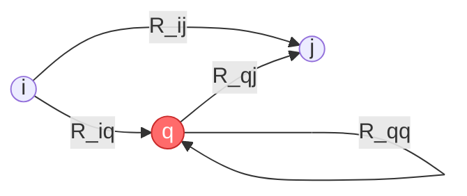
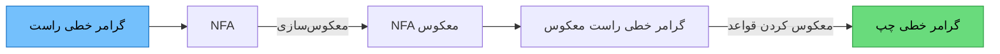

# 📘 جزوه فصل ۳: زبان‌ها و گرامرهای منظم

> [!info] منبع
> عبارت‌های منظم، ارتباط با ماشین‌ها و گرامرهای منظم — ویژه کنکور

---

## 1️⃣ عبارت‌های منظم (Regular Expressions)

### 1-1) عبارت‌های پایه‌ای منظم

> [!note] تعریف
> عبارت منظم (RE) روشی جبری برای توصیف زبان‌های منظم است.

**عبارت‌های پایه‌ای:**

| عبارت | زبان | توضیح |
|---|---|---|
| $\emptyset$ | $L(\emptyset) = \emptyset$ | زبان خالی |
| $\lambda$ | $L(\lambda) = \{\lambda\}$ | رشته تهی |
| $a$ (که $a \in \Sigma$) | $L(a) = \{a\}$ | نماد تک |

> [!danger] دام تستی مهم
> $$L(\lambda) = \{\lambda\} \neq \emptyset = L(\emptyset)$$
> 
> - $\lambda$ یک **رشته** است (طول صفر)
> - $\emptyset$ یک **زبان** است (بدون هیچ رشته)

---

### 1-2) عملیات‌های منظم

> [!abstract] سه عملگر اصلی
> 
> | عملگر | نماد | زبان |
> |---|---|---|
> | اجتماع (Union) | $r_1 + r_2$ یا $r_1 \mid r_2$ | $L(r_1) \cup L(r_2)$ |
> | الحاق (Concatenation) | $r_1 \cdot r_2$ | $L(r_1) \cdot L(r_2)$ |
> | بستار ستاره (Kleene Star) | $r^*$ | $(L(r))^*$ |

**تعاریف دقیق:**

$$L(r_1 + r_2) = L(r_1) \cup L(r_2)$$
$$L(r_1 \cdot r_2) = \{xy \mid x \in L(r_1),\ y \in L(r_2)\}$$
$$L(r^*) = (L(r))^* = \bigcup_{i=0}^{\infty} L(r)^i$$

---

### 1-3) اولویت عملگرها

> [!tip] ترتیب اولویت (از بالا به پایین)
> 
> 1. 🥇 **بستار ستاره** $^*$
> 2. 🥈 **الحاق** $\cdot$
> 3. 🥉 **اجتماع** $+$
> 
> **مثال:** $ab^* + c$ یعنی $(a(b^*)) + c$ — نه $(ab)^* + c$

---

### 1-4) خواص و هم‌ارزی‌های عبارت‌های منظم

> [!success] هم‌ارزی‌های پرکاربرد
> 
> **بستار:**
> $$(a^*)^* = a^* \qquad a^*a^*a^* = a^*$$
> $$(a^+)^+ = a^+ \qquad (a^*)^+ = a^*$$
> 
> **جابه‌جایی در الحاق:**
> $$(ab)^*a = a(ba)^*$$
> $$(ab)^* = \lambda + a(ba)^*b$$
> 
> **پخش (Distributivity):**
> $$r(s + t) = rs + rt$$
> $$(r + s)t = rt + st$$
> 
> **الحاق با $\lambda$ و $\emptyset$:**
> $$r\lambda = \lambda r = r$$
> $$r\emptyset = \emptyset r = \emptyset$$
> $$r + \emptyset = r$$
> $$r + \lambda \neq r \quad \text{(مگر } \lambda \in L(r) \text{)}$$
> $$r^* = \lambda + r^* \qquad r^* = \lambda + rr^*$$
> $$\lambda^* = \lambda \qquad \emptyset^* = \lambda$$

> [!important] هم‌ارزی‌های $(a+b)^*$
> 
> | عبارت | معادل |
> |---|---|
> | $(a+b)^*$ | $(a^*b^*)^*$ |
> | $(a+b)^*$ | $(a^* + b^*)^*$ |
> | $(a+b)^*$ | $(ab^*)^*a^*$ |
> | $b^*a^* \cap a^*b^*$ | $a^* \cup b^*$ |

> [!warning] هم‌ارزی‌های اشتباه رایج
> - $r + \lambda = r$ ❌ (نادرست است مگر $\lambda \in L(r)$)
> - $(ab)^* = a^*b^*$ ❌
> - $r^* = r^+$ ❌ (مگر $\lambda \in L(r)$)

---

## 2️⃣ ارتباط بین عبارت‌های منظم و زبان‌های منظم

> [!note] قضیه بنیادی (کلین)
> هر زبان منظم را می‌توان با یک عبارت منظم توصیف کرد و بالعکس.
> 
> $$\text{زبان منظم} \iff \text{قابل توصیف با RE}$$
> 
> $$\text{زبان منظم} \iff \text{پذیرفته توسط DFA/NFA}$$

---

### 2-1) تبدیل عبارت منظم به ماشین متناهی (روش تامسون)

> [!success] الگوهای پایه ساخت NFA-λ
> 
> **الگوی ۱ — نماد $a$:**
> ```mermaid
> graph LR
>     s((s)) -->|a| f(((f)))
>     style s fill:#74c0fc,stroke:#1971c2,color:#000
>     style f fill:#69db7c,stroke:#2f9e44,color:#000
> ```
> 
> **الگوی ۲ — اجتماع $r_1 + r_2$:**
> ```mermaid
> graph LR
>     s((s)) -->|λ| s1((s1))
>     s -->|λ| s2((s2))
>     s1 --> M1["NFA(r₁)"] --> f1(((f1)))
>     s2 --> M2["NFA(r₂)"] --> f2(((f2)))
>     f1 -->|λ| f(((f)))
>     f2 -->|λ| f
>     style s fill:#74c0fc,stroke:#1971c2,color:#000
>     style f fill:#69db7c,stroke:#2f9e44,color:#000
> ```
> 
> **الگوی ۳ — الحاق $r_1 r_2$:**
> ```mermaid
> graph LR
>     s((s)) --> M1["NFA(r₁)"] --> mid((mid)) --> M2["NFA(r₂)"] --> f(((f)))
>     style s fill:#74c0fc,stroke:#1971c2,color:#000
>     style f fill:#69db7c,stroke:#2f9e44,color:#000
> ```
> 
> **الگوی ۴ — بستار $r^*$:**
> ```mermaid
> graph LR
>     s((s)) -->|λ| s1((s1))
>     s -->|λ| f(((f)))
>     s1 --> M1["NFA(r)"] --> f1(((f1)))
>     f1 -->|λ| f
>     f1 -->|λ| s1
>     style s fill:#74c0fc,stroke:#1971c2,color:#000
>     style f fill:#69db7c,stroke:#2f9e44,color:#000
> ```

> [!tip] نکات روش تامسون
> - هر عبارت منظم به یک NFA با **یک حالت شروع و یک حالت پایانی** تبدیل می‌شود.
> - از $\lambda$-انتقال به‌وفور استفاده می‌شود.
> - سپس با روش زیرمجموعه‌ها به DFA تبدیل می‌شود.

---

### 2-2) تبدیل ماشین متناهی به عبارت منظم (GTG)

> [!abstract] گراف انتقال تعمیم‌یافته (Generalized Transition Graph)
> گرافی که یال‌های آن با **عبارت منظم** برچسب خورده‌اند (نه فقط نماد).

> [!success] روش حذف حالت (State Elimination)
> 
> **گام ۱:** ماشین را به GTG تبدیل کن (یال‌ها با RE).
> 
> **گام ۲:** یک حالت شروع جدید $s$ و حالت پایانی جدید $f$ اضافه کن.
> 
> **گام ۳:** حالت‌ها را **یکی‌یکی حذف** کن. برای حذف حالت $q$:
> 
> $$R_{ij}^{new} = R_{ij} + R_{iq} \cdot (R_{qq})^* \cdot R_{qj}$$
> 
> **گام ۴:** وقتی فقط $s$ و $f$ ماندند، برچسب یال $s \to f$ همان RE است.



> [!tip] نکته
> ترتیب حذف حالت‌ها روی **سادگی** جواب اثر دارد ولی روی **درستی** آن نه.

---

## 3️⃣ گرامرهای منظم (Regular Grammars)

> [!note] تعریف
> گرامر منظم (Type 3) به دو شکل است:
> 
> **خطی راست (Right-Linear):**
> $$A \to aB \quad \text{یا} \quad A \to a \quad \text{یا} \quad A \to \lambda$$
> 
> **خطی چپ (Left-Linear):**
> $$A \to Ba \quad \text{یا} \quad A \to a \quad \text{یا} \quad A \to \lambda$$
> 
> ⚠️ **نمی‌توان** در یک گرامر، هر دو نوع را با هم داشت (مگر حالات خاص).

---

### 3-1) تبدیل گرامر منظم (خطی راست) به NFA

> [!success] قواعد تبدیل
> 
> | قاعده گرامر | انتقال در NFA |
> |---|---|
> | $A \to aB$ | $A \xrightarrow{a} B$ |
> | $A \to a$ | $A \xrightarrow{a} F$ (حالت پایانی) |
> | $A \to \lambda$ | $A$ را پایانی کن |
> 
> **مراحل:**
> 1. برای هر متغیر یک حالت بساز.
> 2. متغیر شروع = حالت شروع.
> 3. قاعده $A \to aB$ را به یال $A \xrightarrow{a} B$ تبدیل کن.
> 4. قاعده $A \to a$ را به یال $A \xrightarrow{a} F$ تبدیل کن.
> 5. یک حالت پایانی جدید $F$ بساز.

> [!warning] نکات پایانی
> - اگر $S \to \lambda$ وجود دارد، حالت شروع **پایانی** است.
> - حالت پایانی $F$ **فقط** برای قواعد $A \to a$ لازم است.

---

### 3-2) تبدیل NFA به گرامر منظم

> [!success] قواعد تبدیل
> 
> | انتقال در NFA | قاعده گرامر |
> |---|---|
> | $A \xrightarrow{a} B$ | $A \to aB$ |
> | $A \xrightarrow{a} F$ (پایانی) | $A \to a$ |
> | $q_0$ پایانی است | $S \to \lambda$ |

> [!tip] نکته
> اگر از حالت $A$ با نماد $a$ به چندین حالت برویم، قواعد متعدد تولید می‌شوند.

---

### 3-3) تبدیل گرامر منظم به عبارت منظم

> [!success] مراحل
> 1. گرامر را به NFA تبدیل کن (بخش 3-1).
> 2. NFA را به GTG تبدیل کن.
> 3. با روش حذف حالت، RE را استخراج کن.

---

### 3-4) تبدیل عبارت منظم به گرامر منظم

> [!success] مراحل
> 1. عبارت منظم را با روش تامسون به NFA تبدیل کن.
> 2. NFA را به گرامر خطی راست تبدیل کن (بخش 3-2).

---

### 3-5) تبدیل گرامر خطی راست به گرامر خطی چپ

> [!abstract] سه روش اصلی

#### 🔹 روش ۱: روش اشتقاق

> [!success] مراحل
> 1. گرامر خطی راست $G_R$ را به NFA تبدیل کن.
> 2. NFA را **معکوس** کن (یال‌ها برعکس، $q_0 \leftrightarrow F$).
> 3. NFA معکوس را به گرامر خطی راست $G_R'$ تبدیل کن.
> 4. گرامر $G_R'$ را **معکوس** کن (خطی راست → خطی چپ).
> 
> نتیجه: گرامر خطی چپ $G_L$ با $L(G_L) = L(G_R)$.

#### 🔹 روش ۲: گراف انتقال تعمیم‌یافته

> [!success] مراحل
> 1. گرامر خطی راست را به GTG تبدیل کن.
> 2. زبان $L$ را از GTG استخراج کن.
> 3. برای $L$ یک گرامر خطی چپ بساز.

#### 🔹 روش ۳: معکوس‌سازی گراف

> [!success] مراحل
> 1. گرامر خطی راست → NFA.
> 2. NFA را معکوس کن (حالت اولیه/نهایی جابه‌جا، یال‌ها برعکس).
> 3. NFA معکوس → گرامر خطی راست $G_R'$.
> 4. $G_R'$ را معکوس کن → گرامر خطی چپ $G_L$.
> 
> 💡 **نکته کلیدی:** روش ۱ و ۳ در عمل یکسان‌اند.



> [!tip] نکته
> گرامر خطی راست و خطی چپ **هم‌ارز** هستند (یک زبان را توصیف می‌کنند).

---

## 🎯 جمع‌بندی نهایی و نکات طلایی

> [!success] نکات طلایی کنکور
> 
> **عبارت‌های منظم:**
> 1. $L(\lambda) = \{\lambda\} \neq \emptyset = L(\emptyset)$
> 2. اولویت: $^* > \cdot > +$
> 3. $r + \lambda \neq r$ (مگر $\lambda \in L(r)$)
> 4. $\emptyset^* = \lambda$ و $\lambda^* = \lambda$
> 5. $(ab)^*a = a(ba)^*$
> 6. $b^*a^* \cap a^*b^* = a^* \cup b^*$
> 
> **تبدیل‌ها:**
> 7. RE → NFA: روش تامسون (با $\lambda$-انتقال)
> 8. DFA/NFA → RE: GTG + حذف حالت
> 9. گرامر خطی راست ↔ NFA (تبدیل مستقیم)
> 10. تبدیل خطی راست به چپ: معکوس‌سازی NFA + معکوس قواعد
> 
> **نکات مهم:**
> 11. هر زبان منظم ⟺ RE ⟺ DFA ⟺ NFA ⟺ گرامر منظم
> 12. گرامر خطی راست و چپ هم‌ارزند.
> 13. در تبدیل گرامر به NFA، قاعده $A \to a$ به یال $A \xrightarrow{a} F$ تبدیل می‌شود.

---

> [!quote] 🗺️ نقشه ذهنی فصل
> ```mermaid
> mindmap
>   root((زبان‌های منظم))
>     عبارت منظم
>       پایه: ∅ λ a
>       عملگرها: + . *
>       اولویت
>       هم‌ارزی‌ها
>     تبدیل‌ها
>       RE → NFA (تامسون)
>       DFA → RE (GTG)
>     گرامر منظم
>       خطی راست
>       خطی چپ
>       گرامر ↔ NFA
>       خطی راست ↔ چپ
> ```

---

> [!example] جدول خلاصه تبدیل‌ها
> 
> | از | به | روش |
> |---|---|---|
> | RE | NFA | تامسون |
> | DFA/NFA | RE | GTG + حذف حالت |
> | گرامر خطی راست | NFA | قواعد مستقیم |
> | NFA | گرامر خطی راست | قواعد مستقیم |
> | گرامر خطی راست | گرامر خطی چپ | معکوس‌سازی NFA |
> | RE | گرامر منظم | تامسون + تبدیل NFA→گرامر |
> | گرامر منظم | RE | گرامر→NFA + GTG |

---

✅ **آماده پیست در Obsidian!**

> [!tip] پیشنهاد ساختار Note ها
> - `[[Regular-Expressions]]`
> - `[[RE-to-NFA-Thompson]]`
> - `[[NFA-to-RE-GTG]]`
> - `[[Regular-Grammars]]`
> - `[[Right-to-Left-Linear]]`