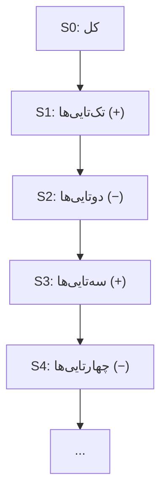

# 🎯 جزوه‌ی ترکیبیات — شمول و عدم شمول و مجموعه‌ها

> [!info] پیش‌نیاز
> ادامه‌ی جزوه‌ی اصول شمارش. تمرکز روی **مجموعه‌ها، شمول و طرد، و تعمیم‌های کنکوری**.

---

## ۱. تعریف مجموعه

> [!abstract] تعریف
> **مجموعه** گردایه‌ای از اشیاء متمایز است. ترتیب مهم نیست و اعضاء تکراری شمرده نمی‌شوند.

### ۱.۱ اعمال مجموعه‌ها

> [!note] برابر بودن دو مجموعه
> $A = B$ اگر و تنها اگر $A \subseteq B$ و $B \subseteq A$.

> [!note] انواع زیرمجموعه
> - **زیرمجموعه (⊆):** هر عضو $A$ در $B$ باشد.
> - **زیرمجموعه‌ی محض (⊂):** $A \subseteq B$ و $A \neq B$.
> - **ابر مجموعه (⊇):** برعکس زیرمجموعه.

> [!note] تعداد زیرمجموعه‌ها
> مجموعه‌ای با $n$ عضو:
> $$ 2^n $$
>  تعداد زیرمجموعه‌های محض $$ 2^n - 1 $$
> تعداد زیرمجموعه‌های  k  عضوی $$ \binom{n}{k} $$
>  تعداد زیرمجموعه‌های ناتهی$$ 2^n - 1 $$

> [!tip] نکته
> تعداد زیرمجموعه‌های **زوج‌عضوی** = تعداد **فردعضوی** $= 2^{n-1}$ $برای $n \geq 1$$.

۱.۲ عملیات روی مجموعه‌ها
-

> [!note] تعاریف
> | عملیات | نماد | تعریف |
> |---|---|---|
> | اجتماع | $A \cup B$ | $\{x : x \in A \text{ یا } x \in B\}$ |
> | اشتراک | $A \cap B$ | $\{x : x \in A \text{ و } x \in B\}$ |
> | تفاضل | $A - B$ | $\{x : x \in A, x \notin B\}$ |
> | تفاضل متقارن | $A \triangle B$ | $(A-B) \cup (B-A)$ |
> | متمم | $A^c$ | $U - A$ |

> [!note] روابط مهم
> $$ A \triangle B = $A \cup B$ - $A \cap B$ $$
> $$ |A \cup B| = |A| + |B| - |A \cap B| $$
> $$ |A - B| = |A| - |A \cap B| $$

۱.۲.۱ دوگان و اصل دوالیتی
-

> [!note] اصل دوالیتی
> اگر در یک اتحاد مجموعه‌ای، $\cup$ را با $\cap$ و $U$ را با $\emptyset$ عوض کنیم، اتحاد معتبر باقی می‌ماند.

> [!example] مثال
> $$ (A \cup B)^c = A^c \cap B^c $$
> $$ (A \cap B)^c = A^c \cup B^c $$
> (قوانین دمورگان)

۱.۲.۲ قوانین عملیات‌ها
-

> [!note] جدول قوانین
> | قانون | اجتماع | اشتراک |
> |---|---|---|
> | همانی | $A \cup \emptyset = A$ | $A \cap U = A$ |
> | جابه‌جایی | $A \cup B = B \cup A$ | $A \cap B = B \cap A$ |
> | شرکت‌پذیری | $(A \cup B) \cup C = A \cup (B \cup C)$ | مشابه |
> | توزیع‌پذیری | $A \cup $B \cap C$ = $A \cup B$ \cap (A \cup C)$ | مشابه |
> | جذب | $A \cup $A \cap B$ = A$ | $A \cap $A \cup B$ = A$ |
> | متمم | $A \cup A^c = U$ | $A \cap A^c = \emptyset$ |
> | خودتوانی | $A \cup A = A$ | $A \cap A = A$ |

۱.۳ قوانین و نکات ریاضی کاربردی
-

> [!note] دنباله‌ی حسابی
> مجموع $n$ جمله:
> $$ S_n = \frac{n(a_1 + a_n)}{2} $$
> بدست اوردن $n$ از دنباله ${a ,b}$ با قدر نسبت $k$
> $$n = \frac{b - a}{k} + 1$$

> [!note] دنباله‌ی هندسی
> مجموع $n$ جمله:
> $$ S_n = a_1 \cdot \frac{1 - r^n}{1 - r} \quad $r \neq 1$ $$
>  بدست اوردن $n$ از دنباله ${a_1 ,a_n}$ با قدر نسبت $r$ 
> $$n=\log_r\left(\frac{a_n}{a_1}\right) + 1$$

> [!note] تعداد مضرب‌های $k$ در بازه
> تعداد اعداد صحیح مضرب $k$ در بازه‌ی $[a, b]$:
> $$ \left\lfloor \frac{b}{k} \right\rfloor - \left\lfloor \frac{a-1}{k} \right\rfloor $$
> یا معادلاً تعداد $x$ که $a < kx \leq b$:
> $$ \left\lfloor \frac{b}{k} \right\rfloor - \left\lfloor \frac{a}{k} \right\rfloor $$

> [!tip] نکات مرزی
> | شرط | فرمول |
> |---|---|
> | $a < kx < b$ | $\lfloor (b-1)/k \rfloor - \lfloor a/k \rfloor$ |
> | $a \leq kx \leq b$ | $\lfloor b/k \rfloor - \lfloor (a-1)/k \rfloor$ |
> | $a < kx \leq b$ | $\lfloor b/k \rfloor - \lfloor a/k \rfloor$ |
> | $a \leq kx < b$ | $\lfloor (b-1)/k \rfloor - \lfloor (a-1)/k \rfloor$ |

> [!note] تعداد مضرب $k$ در $\{1, 2, \dots, n\}$
> $$ \left\lfloor \frac{n}{k} \right\rfloor $$

-

۲. شمول و عدم شمول (Inclusion-Exclusion)
-

> [!abstract] ایده‌ی اصلی
> برای شمردن اجتماع مجموعه‌ها، **یک بار اضافه، یک بار کم، یک بار اضافه...** می‌کنیم تا همپوشانی‌ها درست حساب شوند.

۲.۱ نمادگذاری $S_i$
-

> [!note] تعریف
> فرض کن $A_1, A_2, \dots, A_n$ مجموعه‌های ما باشند:
> - $S_0$ = تعداد کل (مرجع)
> - $S_1 = \sum |A_i|$ = مجموع تک‌تایی‌ها
> - $S_2 = \sum |A_i \cap A_j|$ = مجموع دوتایی‌ها
> - $S_k = \sum |A_{i_1} \cap \dots \cap A_{i_k}|$ = مجموع $k$-تایی‌ها

> [!note] فرمول شمول و طرد برای اجتماع
> $$ |A_1 \cup A_2 \cup \dots \cup A_n| = S_1 - S_2 + S_3 - S_4 + \dots + (-1)^{n+1} S_n $$

> [!note] تعداد اعضایی که در هیچ مجموعه‌ای نیستند
> $$ |A_1^c \cap A_2^c \cap \dots \cap A_n^c| = S_0 - S_1 + S_2 - S_3 + \dots + (-1)^n S_n $$

> [!example] مثال
> $|A \cup B \cup C| = |A| + |B| + |C| - |A \cap B| - |A \cap C| - |B \cap C| + |A \cap B \cap C|$

---

## ۳. تعمیم اصل شمول و طرد

> [!note] تعریف $L_m$ و $E_m$
> - $L_m$ = تعداد اعضایی که **حداقل در $m$ تا** از مجموعه‌ها هستند.
> - $E_m$ = تعداد اعضایی که **دقیقاً در $m$ تا** از مجموعه‌ها هستند.

> [!note] فرمول $E_m$ (دقیقاً $m$ تا)
> $$ E_m = S_m - \binom{m+1}{1} S_{m+1} + \binom{m+2}{2} S_{m+2} - \dots $$
> به‌صورت خلاصه:
> $$\sum_{k=1}^{n-m} (-1)^{k} \binom{m+k}{k} S_{m+n}$$

> [!note] فرمول $L_m$ (حداقل $m$ تا)
> $$ L_m = S_m - \binom{m}{m-1} S_{m+1} + \binom{m+1}{m-1} S_{m+2} - \dots $$
> به‌صورت خلاصه:
> $$ L_m = \sum_{k=m}^{n} (-1)^{k-m} \binom{k-1}{m-1} S_k $$

> [!tip] رابطه‌ی $E$ و $L$
> $$ L_m = E_m + E_{m+1} + E_{m+2} + \dots $$
> $$ E_m = L_m - L_{m+1} $$

> [!example] مثال مهم
> اگر بخواهیم تعداد اعضایی که **دقیقاً در ۱ مجموعه** هستند:
> $$ E_1 = S_1 - 2S_2 + 3S_3 - 4S_4 + \dots $$
> اگر بخواهیم تعداد اعضایی که **حداقل در ۱ مجموعه** هستند (همان اجتماع):
> $$ L_1 = S_1 - S_2 + S_3 - S_4 + \dots $$

---

## 🧭 راهنمای انتخاب روش

> [!tip] کدام روش برای کدام سوال؟
> | نوع سوال | روش |
> |---|---|
> | اجتماع مجموعه‌ها | شمول و طرد $$S_1 - S_2 + \dots$$ |
> | هیچ‌کدام (متمم اجتماع) | $S_0 - S_1 + S_2 - \dots$ |
> | دقیقاً $m$ تا | فرمول $E_m$ |
> | حداقل $m$ تا | فرمول $L_m$ |
> | مضرب‌های $k$ در بازه | $\lfloor b/k \rfloor - \lfloor a/k \rfloor$ |
> | تعداد زیرمجموعه | $2^n$ |
> | زیرمجموعه‌ی $k$ عضوی | $\binom{n}{k}$ |

> [!warning] دام‌های کنکوری
> - **«حداقل» و «دقیقاً» را قاطی نکن!** حداقل $m$ یعنی $L_m$، دقیقاً $m$ یعنی $E_m$.
> - در شمول و طرد، علامت‌ها یکی‌درمیان عوض می‌شوند: $+ - + - \dots$
> - $S_0$ را فراموش نکن — خیلی‌ها فقط از $S_1$ شروع می‌کنند.
> - در فرمول $E_m$، ضرایب$\binom{m+k}{k}$.

---

## 📋 جدول خلاصه‌ی فرمول‌ها

| موضوع                 | فرمول                                            |
| --------------------- | ------------------------------------------------ |
| تعداد زیرمجموعه‌ها    | $2^n$                                            |
| اجتماع دو مجموعه      | $A + B - A\cap B$                                |
| اجتماع $n$ مجموعه     | $S_1 - S_2 + S_3 - \dots$                        |
| هیچ‌کدام              | $S_0 - S_1 + S_2 - \dots$                        |
| دقیقاً $m$ تا $$E_m$$ | $\sum_{k=1}^{n-m} (-1)^{k} \binom{m+k}{k} S_k$   |
| حداقل $m$ تا $$L_m$$  | $\sum_{k=m}^{n} (-1)^{k-m} \binom{k-1}{m-1} S_k$ |
| مضرب $k$ در $[a,b]$   | $\lfloor b/k \rfloor - \lfloor (a-1)/k \rfloor$  |
| دمورگان               | $(A \cup B)^c = A^c \cap B^c$                    |

---

> [!success] نکته‌ی نهایی کنکوری
> - **«حداقل یکی»** → شمول و طرد ساده $$L_1$$
> - **«هیچ‌کدام»** → متمم $$S_0 - S_1 + S_2 - \dots$$
> - **«دقیقاً $m$ تا»** → $E_m$
> - **«حداقل $m$ تا»** → $L_m$
> - **«مضرب‌ها»** → تقسیم صحیح و تفاضل کف‌ها
> - **«زیرمجموعه»** → $2^n$ یا $\binom{n}{k}$

