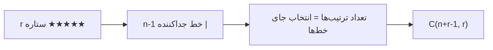

# 🧮 جزوه‌ی ترکیبیات — اصول اولیه‌ی شمارش

> [!info] پیش‌نیاز
> این جزوه برای مرور سریع کنکور نوشته شده. تمرکز روی **فرمول‌ها و ایده‌های کلیدی** است.

---

## ۱. اصل ضرب و اصل جمع

> [!note] اصل ضرب (Multiplication Principle)
> اگر کاری $k$ مرحله داشته باشد و مرحله‌ی $i$ام به $n_i$ روش انجام شود، کل کار به:
> $$ n_1 \times n_2 \times \dots \times n_k $$
> روش انجام می‌شود.
> **کلید:** مراحل **مستقل** و **پشت سر هم** باشند.

> [!note] اصل جمع (Addition Principle)
> اگر کاری $k$ حالت **جدا از هم** (بدون همپوشانی) داشته باشد و حالت $i$ام به $n_i$ روش انجام شود، کل کار به:
> $$ n_1 + n_2 + \dots + n_k $$
> روش انجام می‌شود.
> **کلید:** حالت‌ها **ناگذر** باشند.

> [!warning] نکته‌ی کنکوری
> اگر بین حالت‌ها همپوشانی باشد، نباید ساده جمع کرد. باید از **اصل شمول و عدم شمول** استفاده کرد:
> $$ |A \cup B| = |A| + |B| - |A \cap B| $$

---

## ۲. جایگشت (Permutation)

> [!abstract] تعریف
> **جایگشت** یعنی چیدن اشیاء در **ترتیب مهم**. جای `A B` با `B A` فرق دارد.

### ۲.۱ جایگشت بدون تکرار

> [!note] فرمول
> تعداد جایگشت $r$ شیء از $n$ شیء متمایز:
> $$ P(n, r) = \frac{n!}{(n-r)!} $$
> حالت خاص $r = n$:
> $$ P(n, n) = n! $$

### ۲.۲ جایگشت با تکرار

> [!note] فرمول
> اگر هر شیء بتواند چند بار بیاید، تعداد رشته‌های به طول $r$ از $n$ نوع شیء:
> $$ n^r $$

### ۲.۳ جایگشت با اشیاء تکراری

> [!note] فرمول
> اگر $n$ شیء داشته باشیم که $n_1$ تا از نوع اول، $n_2$ تا از نوع دوم، ... و $n_k$ تا از نوع $k$ام باشند:
> $$ \frac{n!}{n_1! \, n_2! \dots n_k!} $$
> **مثال:** `llmmw` → $\dfrac{5!}{2! \cdot 2!} = 30$

> [!tip] شهود تقسیم
> هر چیدمان واقعی را به تعداد $n_1! \cdot n_2! \dots n_k!$ بار اشتباهی شمرده‌ایم (چون اشیاء یکسان را متمایز فرض کرده‌ایم).

### ۲.۴ جایگشت دایره‌ای و دستبند

> [!note] جایگشت دایره‌ای
> چیدن $n$ نفر دور میز گرد:
> $$ (n-1)! $$
> **چرا؟** یک نفر را ثابت می‌کنیم تا دوران‌ها حذف شوند.

> [!note] جایگشت دستبند (Necklace)
> اگر چیدمان را بتوان **چرخاند و برگرداند** (مثل دستبند):
> $$ \frac{(n-1)!}{2} $$
> (برای $n \geq 3$)

> [!example] مثال ترکیبی
> ۳ دختر و ۳ پسر یک‌درمیان دور میز:
> $$ 3! \times 2! = 12 $$
> (یک پسر ثابت، ۳ دختر جایگشت، ۲ پسر باقی‌مانده جایگشت)

---

## ۳. ترکیب (Combination)

> [!abstract] تعریف
> **ترکیب** یعنی انتخاب بدون اهمیت ترتیب. `{A, B}` با `{B, A}` یکی است.

### ۳.۱ ترکیب بدون تکرار

> [!note] فرمول
> انتخاب $r$ شیء از $n$ شیء متمایز:
> $$ \binom{n}{r} = \frac{n!}{r!(n-r)!} $$

> [!tip] ویژگی‌های مهم
> $$ \binom{n}{r} = \binom{n}{n-r} $$
> $$ \binom{n}{0} = \binom{n}{n} = 1 $$

### ۳.۲ اعداد صحیح و نامساوی‌ها

> [!note] حالت اکید (بدون تکرار)
> تعداد جواب‌های:
> $$ 1 \leq x_1 < x_2 < \dots < x_r \leq n $$
> برابر است با:
> $$ \binom{n}{r} $$

> [!note] حالت نامساوی با تساوی
> تعداد جواب‌های:
> $$ 1 \leq x_1 \leq x_2 \leq \dots \leq x_r \leq n $$
> برابر است با **ترکیب با تکرار**:
> $$ \binom{n + r - 1}{r} $$

> [!warning] ترفند
> اگر $x_1 < x_2 < \dots < x_r$ باشد، مستقیم ترکیب بدون تکرار. اگر $\leq$ باشد، ترکیب با تکرار.

### ۳.۳ ترکیب با تکرار (ستاره و خط)

> [!note] قضیه‌ی ستاره و خط (Stars and Bars)
> تعداد جواب‌های صحیح **نامنفی** معادله:
> $$ x_1 + x_2 + \dots + x_n = r $$
> برابر است با:
> $$ \binom{n + r - 1}{r} = \binom{n + r - 1}{n - 1} $$

> [!note] حالت‌های مختلف معادله
> | شرط | تبدیل | فرمول |
> |---|---|---|
> | $x_i \geq 0$ | بدون تغییر | $\binom{n+r-1}{r}$ |
> | $x_i \geq 1$ | $y_i = x_i - 1$ | $\binom{r-1}{n-1}$ |
> | $x_i \geq a$ | $y_i = x_i - a$ | $\binom{n+r-na-1}{r-na}$ |
> | $x_1 \geq 2, x_2 \geq 3$ | جدا کم کن | $\binom{n + r' - 1}{r'}$ |

> [!example] مثال
> $x_1 + x_2 + x_3 = 10$ با $x_i \geq 0$:
> $$ \binom{3+10-1}{10} = \binom{12}{10} = 66 $$
> با $x_i \geq 1$:
> $$ \binom{10-1}{3-1} = \binom{9}{2} = 36 $$

---

## ۴. توزیع اشیاء در جعبه‌ها

> [!note] جدول توزیع $r$ شیء در $n$ جعبه‌ی متمایز
> | اشیاء | جعبه‌ها | خالی مجاز؟ | فرمول |
> |---|---|---|---|
> | متمایز | متمایز | بله | $n^r$ |
> | متمایز | متمایز | خیر | $n! \cdot S(r,n)$ |
> | یکسان | متمایز | بله | $\binom{n+r-1}{r}$ |
> | یکسان | متمایز | خیر | $\binom{r-1}{n-1}$ |
> | یکسان | یکسان | بله | افراز عدد |
> | متمایز | یکسان | بله | عدد بل |

> [!tip] نکته
> در کنکور معمولاً **اشیاء یکسان + جعبه‌های متمایز** می‌آید که همان ستاره و خط است.

> [!note] مثال از عدد استرلینگ و روش جایگزین با شمول عدم شمول 
> $$
n! \cdot S(r,n) = \sum_{i=0}^{n} (-1)^i \binom{n}{i} (n-i)^r
$$ 

> مثال:  ۴ شی متمایز در ۲ جعبه متمایز 
> 
$$
\sum_{i=0}^{2} (-1)^i \binom{2}{i} (2-i)^4 = \binom{2}{0}2^4 - \binom{2}{1}1^4 + \binom{2}{2}0^4 = 16 - 2 + 0 = 14
$$
> 

---

## ۵. بسط دو جمله‌ای و چند جمله‌ای

### ۵.۱ بسط دو جمله‌ای

> [!note] قضیه‌ی دو جمله‌ای
> $$ (x+y)^n = \sum_{k=0}^{n} \binom{n}{k} x^{n-k} y^k $$

> [!note] نتایج مهم
> $$ \sum_{k=0}^{n} \binom{n}{k} = 2^n $$
> $$ \sum_{k=0}^{n} (-1)^k \binom{n}{k} = 0 $$
> $$ \sum_{k=0}^{n} \binom{n}{k} 2^k = 3^n $$
> $$ \sum_{k=0}^{n} k \binom{n}{k} = n \cdot 2^{n-1} $$
>   $$ \sum_{k=0}^{n}  \binom{n}{k} ^2 = \binom{2n}{n} $$
>  $$ \sum_{k=0}^{n} k \binom{n}{k} ^2 = n \binom{2n-1}{n-1} $$
>  $$ \sum_{k=0}^{K} \binom{n+k}{n} = \binom {n+K+1}{n+1} $$

### ۵.۲ بسط چند جمله‌ای

> [!note] قضیه‌ی چند جمله‌ای
> $$ (x_1 + x_2 + \dots + x_k)^n = \sum \frac{n!}{n_1! \, n_2! \dots n_k!} x_1^{n_1} x_2^{n_2} \dots x_k^{n_k} $$
> که $n_1 + n_2 + \dots + n_k = n$.

> [!note] تعداد جملات بسط
> تعداد جملات متمایز در بسط $(x_1 + \dots + x_k)^n$:
> $$ \binom{n + k - 1}{k - 1} = \binom{n+k-1}{n} $$

> [!example] مثال
> $(x+y+z)^4$ → تعداد جملات:
> $$ \binom{4+3-1}{3-1} = \binom{6}{2} = 15 $$
> ضریب $x^2 y z$:
> $$ \frac{4!}{2! \cdot 1! \cdot 1!} = 12 $$

---

## ۶. قواعد مهم ترکیب‌ها

> [!note] قاعده‌ی پاسکال
> $$ \binom{n}{k} = \binom{n-1}{k-1} + \binom{n-1}{k} $$

> [!note] اتحاد واندرموند (Vandermonde)
> $$ \binom{m+n}{k} = \sum_{i=0}^{k} \binom{m}{i} \binom{n}{k-i} $$

> [!note] اتحادهای مفید دیگر
> $$ \binom{n}{k} = \frac{n}{k} \binom{n-1}{k-1} $$
> $$ \binom{n}{k} \binom{k}{r} = \binom{n}{r} \binom{n-r}{k-r} $$
> $$ k \binom{n}{k} = n \binom {n-1}{k-1} $$

### ۶.۱ قضایای اضافی — شمارش مربع و مستطیل

> [!note] تعداد مستطیل‌ها در صفحه‌ی $n \times m$
> برای انتخاب یک مستطیل باید ۲ خط افقی و ۲ خط عمودی انتخاب کنیم:
> $$ \binom{n+1}{2} \binom{m+1}{2} $$
> تعداد مربع‌ها در صفحه $n \times n$:
> $$ \sum_{k=1}^{n} k^2 = \frac{n(n+1)(2n+1)}{6} $$

---

## ۷. فرمول‌های اضافه

### ۷.۱ جفت‌سازی $2n$ شیء

> [!note] فرمول
> تعداد روش‌های تشکیل $n$ جفت از $2n$ شیء متمایز:
> $$ \frac{(2n)!}{2^n \cdot n!} $$

> [!tip] چرا؟
> $2n$ شیء را جایگشت می‌دهیم ($(2n)!$)، سپس هر جفت را تقسیم بر n تا  $2!$ یعنی($2^n$) و ترتیب جفت‌ها را حذف ($n!$).

### ۷.۲ پیچیدگی زمانی حلقه‌های تو در تو

> [!note] فرمول
> برای $k$ حلقه‌ی تو در تو با شرط $i_1 < i_2 < \dots < i_k$:
> $$ \binom{n + k - 1}{k} $$
> که $n$ محدوده‌ی مقادیر است.

### ۷.۳ انتخاب با فاصله (Gap Method)

> [!note] حالت خطی
> از $n$ شیء، $k$ شیء انتخاب کن که هیچ دو نفری کنار هم نباشند:
> $$ \binom{n - k + 1}{k} $$

> [!note] حالت با فاصله‌ی حداقل $d$
> (یعنی $d-1$ شیء بین‌شان باشد):
> $$ \binom{n - (k-1)(d-1)}{k} $$

> [!note] حالت دایره‌ای
> از $n$ نفر دور میز، $k$ نفر بدون کنار هم بودن:
> $$ \binom{n-k}{k} + \binom{n-k-1}{k-1} $$

> [!tip] شهود
> برای هر نفر بعدی، «صندلی‌های اجباری» را از مجموعه کم کن. نفر اول صندلی اجباری ندارد چون کسی قبلش نیست.

### ۷.۴ افراز عدد $n$

> [!note] نوشتن $n$ به‌عنوان مجموع اعداد طبیعی
> تعداد روش‌های نوشتن $n$ به‌صورت مجموع اعداد طبیعی (ترتیب مهم):
> $$ 2^{n-1} $$
> **چرا؟** بین $n$ تا $1$، $n-1$ جای «برش» داریم.

> [!note] افرازهای متقارن
> تعداد افرازهای متقارن (که با خواندن از دو طرف یکی باشند):
> $$ 2^{\lfloor n/2 \rfloor} $$

> [!example] مثال
> $n = 4$:
> - کل افرازها: $2^3 = 8$
> - متقارن‌ها: $2^2 = 4$

---

## 📋 جدول خلاصه‌ی فرمول‌ها

| موضوع | فرمول |
|---|---|
| جایگشت $r$ از $n$ | $\dfrac{n!}{(n-r)!}$ |
| جایگشت با تکرار | $n^r$ |
| جایگشت با اشیاء تکراری | $\dfrac{n!}{n_1! \dots n_k!}$ |
| دایره‌ای | $(n-1)!$ |
| دستبند | $\dfrac{(n-1)!}{2}$ |
| ترکیب $r$ از $n$ | $\binom{n}{r}$ |
| ستاره و خط | $\binom{n+r-1}{r}$ |
| انتخاب با فاصله | $\binom{n-k+1}{k}$ |
| دایره‌ای با فاصله | $\binom{n-k}{k} + \binom{n-k-1}{k-1}$ |
| بسط دو جمله‌ای | $\sum \binom{n}{k} x^{n-k} y^k$ |
| مجموع ضرایب | $2^n$ |
| جفت‌سازی | $\dfrac{(2n)!}{2^n n!}$ |

---

> [!success] نکته‌ی نهایی کنکوری
> - **ترتیب مهم؟** → جایگشت
> - **ترتیب مهم نیست؟** → ترکیب
> - **تکرار مجاز؟** → ستاره و خط
> - **دور میز؟** → یک نفر ثابت
> - **بدون کنار هم؟** → روش فاصله
> - **معادله با شرط؟** → تبدیل متغیر و ستاره و خط
