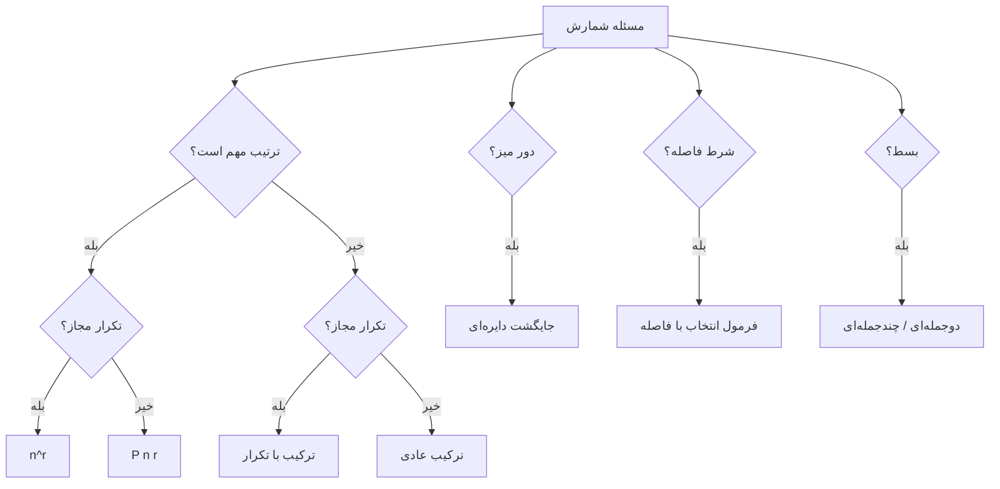

# جزوه‌ی خلاصه‌ی اصول اولیه شمارش

> برای کنکور — خلاصه + فرمول + نمونه‌سوال تشخیصی

---

## ۱. اصل ضرب و اصل جمع

**اصل ضرب:** اگر کاری $k$ مرحله داشته باشد و مرحله‌ی $i$ ام $n_i$ راه داشته باشد، کل راه‌ها:

$$
n_1 \times n_2 \times \dots \times n_k
$$

**اصل جمع:** اگر کار به $k$ حالت **جدا از هم** تقسیم شود و حالت $i$ ام $n_i$ راه داشته باشد:

$$
n_1 + n_2 + \dots + n_k
$$

> **تشخیص:** «و» → ضرب، «یا» → جمع.

**نمونه‌سوال:**
- از شهر A به B ۳ جاده و B به C ۴ جاده است. چند مسیر A به C؟ → اصل ضرب
- از A به B ۳ جاده و از A به C ۵ جاده. چند مسیر A به B یا C؟ → اصل جمع

---

## ۲. جایگشت

### ۲.۱ جایگشت بدون تکرار

انتخاب $r$ شی از $n$ شی متمایز **با ترتیب**:

$$
P(n,r) = \frac{n!}{(n-r)!}
$$

**نمونه‌سوال:** از ۷ نفر، ۳ نفر را برای رئیس، معاون، دبیر انتخاب کن → $P(7,3)$

### ۲.۲ جایگشت با تکرار

$n$ شی متمایز، $r$ جایگاه، هر شی چند بار مجاز:

$$
n^r
$$

**نمونه‌سوال:** با ارقام ۱ تا ۹، چند عدد ۴ رقمی می‌توان ساخت (تکرار مجاز)؟ → $9^4$

### ۲.۳ جایگشت با اشیای تکراری

$n$ شی که $n_1$ تا از نوع اول، $n_2$ تا از نوع دوم، ... :

$$
\frac{n!}{n_1! \, n_2! \dots n_k!}
$$

**نمونه‌سوال:** جایگشت‌های کلمه `llmmw` → $\frac{5!}{2!\,2!}$

### ۲.۴ جایگشت دایره‌ای و دست‌بند

**دایره‌ای** ($n$ نفر دور میز گرد، دوران‌ها یکسان):

$$
(n-1)!
$$

**دست‌بند** (دورگردانی و قرینه یکسان):

$$
\frac{(n-1)!}{2}
$$

**نمونه‌سوال:**
- ۵ نفر دور میز گرد → $4! = 24$
- ۵ مهره برای دست‌بند → $\frac{4!}{2} = 12$

> **نکته:** اگر «یک‌درمیان» یا شرط خاصی بود، اول یک نفر را ثابت کن، بعد بشمار.

---

## ۳. ترکیب‌ها

### ۳.۱ ترکیب بدون تکرار

انتخاب $r$ از $n$ **بدون ترتیب**:

$$
\binom{n}{r} = \frac{n!}{r!(n-r)!}
$$

**نمونه‌سوال:** از ۱۰ نفر، ۳ نفر برای یک تیم (بدون سمت) → $\binom{10}{3}$

### ۳.۲ اعداد صحیح و نامساوی‌ها

**حالت اکید (متمایز):**

$$
1 \le x_1 < x_2 < \dots < x_r \le n
$$

تعداد جواب‌ها:

$$
\binom{n}{r}
$$

**حالت با تکرار (نامساوی غیراکید):**

$$
1 \le x_1 \le x_2 \le \dots \le x_r \le n
$$

تعداد جواب‌ها:

$$
\binom{n+r-1}{r}
$$

**نمونه‌سوال:**
- $1 \le x_1 < x_2 < x_3 \le 8$ → $\binom{8}{3}$
- $1 \le x_1 \le x_2 \le x_3 \le 8$ → $\binom{10}{3}$

### ۳.۳ ترکیب با تکرار و ستاره‌ها و خطوط

تعداد جواب‌های **صحیح نامنفی**:

$$
x_1 + x_2 + \dots + x_n = r, \quad x_i \ge 0
$$

$$
\binom{n+r-1}{r}
$$

**حالت‌های خاص:**

| شرط | تبدیل | فرمول |
|---|---|---|
| $x_i \ge 0$ | — | $\binom{n+r-1}{r}$ |
| $x_i \ge 1$ | $x_i' = x_i - 1$ | $\binom{r-1}{n-1}$ |
| $x_i \ge a$ | $x_i' = x_i - a$ | $\binom{r - na + n - 1}{n-1}$ |
| $x_1 \ge 2,\ x_2 \ge 3$ | کم کردن | $\binom{r - 5 + n - 1}{n-1}$ |

**نمونه‌سوال:**
- $x_1+x_2+x_3 = 10$، $x_i \ge 0$ → $\binom{12}{2}$
- $x_1+x_2+x_3 = 10$، $x_i \ge 1$ → $\binom{9}{2}$
- $x_1+x_2+x_3 = 10$، $x_1 \ge 2,\ x_2 \ge 1$ → $\binom{9}{2}$

> **توزیع $r$ شیء یکسان در $n$ جعبه‌ی متمایز:** همان $\binom{n+r-1}{r}$ است.

---

## ۴. توزیع اشیا در جعبه‌ها

| اشیا | جعبه‌ها | فرمول |
|---|---|---|
| متمایز | متمایز | $n^r$ |
| متمایز | متمایز، خالی نباشد | $n! \cdot S(r,n)$ (عدد استرلینگ) |
| یکسان | متمایز | $\binom{n+r-1}{r}$ |
| یکسان | یکسان | افراز عددی $r$ به حداکثر $n$ بخش |

**نمونه‌سوال:** ۵ توپ یکسان در ۳ جعبه‌ی متمایز → $\binom{7}{2}$

---

## ۵. بسط دو جمله‌ای و چند جمله‌ای

**دو جمله‌ای:**

$$
(x+y)^n = \sum_{k=0}^{n} \binom{n}{k} x^{n-k} y^k
$$

**جمله‌ی عمومی:** $\binom{n}{k} x^{n-k} y^k$

**چند جمله‌ای:**

$$
(x_1 + x_2 + \dots + x_k)^n = \sum \frac{n!}{n_1! n_2! \dots n_k!} x_1^{n_1} \dots x_k^{n_k}
$$

که $\sum n_i = n$.

**تعداد جملات بسط:**

$$
\binom{n+k-1}{k-1}
$$

**ضریب جمله‌ی خاص:**

$$
\frac{n!}{n_1! \, n_2! \dots n_k!}
$$

**نمونه‌سوال:**
- ضریب $x^3 y^2$ در $(x+y)^5$ → $\binom{5}{2}$
- تعداد جملات $(x+y+z)^4$ → $\binom{6}{2}$
- ضریب $x^2 y z$ در $(x+y+z)^4$ → $\frac{4!}{2!\,1!\,1!}$

### ۵.۱ نتایج مهم بسط

$$
\sum_{k=0}^{n} \binom{n}{k} = 2^n
$$

$$
\sum_{k=0}^{n} (-1)^k \binom{n}{k} = 0
$$

$$
\sum_{k=0}^{n} \binom{n}{k} 2^k = 3^n
$$

$$
\sum_{k=0}^{n} \binom{n}{k}^2 = \binom{2n}{n}
$$

**نمونه‌سوال:** حاصل $\sum \binom{10}{k} 2^k$ → $3^{10}$

### ۵.۲ بسط چندجمله‌ای — تعداد جملات

تعداد جملات متمایز $(x_1 + \dots + x_k)^n$:

$$
\binom{n+k-1}{k-1}
$$

**نمونه‌سوال:** تعداد جملات $(a+b+c+d)^5$ → $\binom{8}{3}$

---

## ۶. قواعد مهم ترکیب‌ها

**قاعده‌ی پاسکال:**

$$
\binom{n}{k} = \binom{n-1}{k-1} + \binom{n-1}{k}
$$

**قاعده‌ی چسباندن (Vandermonde):**

$$
\binom{m+n}{k} = \sum_{i=0}^{k} \binom{m}{k-i} \binom{n}{i}
$$

**نتایج مهم:**

$$
\binom{n}{k} = \binom{n}{n-k}
$$

$$
k\binom{n}{k} = n\binom{n-1}{k-1}
$$

**نمونه‌سوال:** $\binom{5}{2} + \binom{5}{3}$ → $\binom{6}{3}$

### ۶.۱ تعداد مربع و مستطیل در صفحه‌ی $n \times n$

**تعداد مستطیل‌ها:**

$$
\binom{n+1}{2}^2
$$

**تعداد مربع‌ها:**

$$
\sum_{k=1}^{n} (n-k+1)^2
$$

**نمونه‌سوال:** در صفحه‌ی $3 \times 3$:
- مستطیل: $\binom{4}{2}^2 = 36$
- مربع: $9+4+1 = 14$

---

## ۷. فرمول‌های اضافه

### ۷.۰ جفت‌سازی $2n$ شیء متمایز به $n$ جفت

$$
\frac{(2n)!}{2^n \cdot n!}
$$

**نمونه‌سوال:** ۶ نفر به ۳ تیم دو نفره → $\frac{6!}{2^3 \cdot 3!} = 15$

### ۷.۱ پیچیدگی زمانی حلقه‌های تو در تو

حلقه‌های تودرتوی وابسته:

$$
\binom{n + \text{loop} - 1}{\text{loop}}
$$

**نمونه‌سوال:**

```
for i = 1 to n:
  for j = i to n:
    for k = j to n:
```

تعداد اجرا → $\binom{n+2}{3}$

### ۷.۲ انتخاب با فاصله (بدون کنار هم)

**خطی** — انتخاب $k$ از $n$ بدون کنار هم:

$$
\binom{n-k+1}{k}
$$

**دایره‌ای** — انتخاب $k$ از $n$ دور میز بدون کنار هم:

$$
\binom{n-k}{k} + \binom{n-k-1}{k-1}
$$

**فاصله‌ی حداقل $d$ (خطی):**

$$
\binom{n - (d-1)(k-1)}{k}
$$

**نمونه‌سوال:**
- از ۱۰ نفر خطی، ۳ نفر بدون کنار هم → $\binom{8}{3}$
- از ۸ نفر دایره‌ای، ۳ نفر بدون کنار هم → $\binom{5}{3} + \binom{4}{2} = 16$

### ۷.۳ افراز $n$ به مجموع اعداد طبیعی

**تعداد کل نوشتن $n$ به‌صورت مجموع اعداد طبیعی (ترتیب مهم):**

$$
2^{n-1}
$$

**تعداد افرازهای متقارن:**

$$
2^{\lfloor n/2 \rfloor}
$$

**نمونه‌سوال:**
- $4 = 1+1+1+1 = 1+1+2 = \dots$ → $2^3 = 8$ حالت (با ترتیب)
- تعداد افرازهای متقارن ۴ → $2^2 = 4$

> **تشخیص:** اگر «ترتیب مهم» بود → $2^{n-1}$، اگر «متقارن» بود → $2^{\lfloor n/2 \rfloor}$.

---

## نمودار تشخیص سریع



---

## جدول جمع‌بندی فرمول‌های کلیدی

| مسئله | فرمول |
|---|---|
| جایگشت $r$ از $n$ | $\frac{n!}{(n-r)!}$ |
| ترکیب $r$ از $n$ | $\binom{n}{r}$ |
| جایگشت با تکرار | $n^r$ |
| جایگشت با اشیای تکراری | $\frac{n!}{n_1! \dots n_k!}$ |
| جایگشت دایره‌ای | $(n-1)!$ |
| دست‌بند | $\frac{(n-1)!}{2}$ |
| ترکیب با تکرار | $\binom{n+r-1}{r}$ |
| بسط دوجمله‌ای | $\binom{n}{k}$ |
| تعداد جملات چندجمله‌ای | $\binom{n+k-1}{k-1}$ |
| انتخاب بدون کنار هم (خطی) | $\binom{n-k+1}{k}$ |
| انتخاب بدون کنار هم (دایره) | $\binom{n-k}{k} + \binom{n-k-1}{k-1}$ |
| افراز $n$ (ترتیب مهم) | $2^{n-1}$ |

---

> **نکته‌ی کنکوری:** قبل از هر سوال، این سه را بپرس:
> ۱. ترتیب مهم است؟ ۲. تکرار مجاز است؟ ۳. خطی است یا دایره‌ای؟
>
> جواب این سه، فرمول را تعیین می‌کند.


