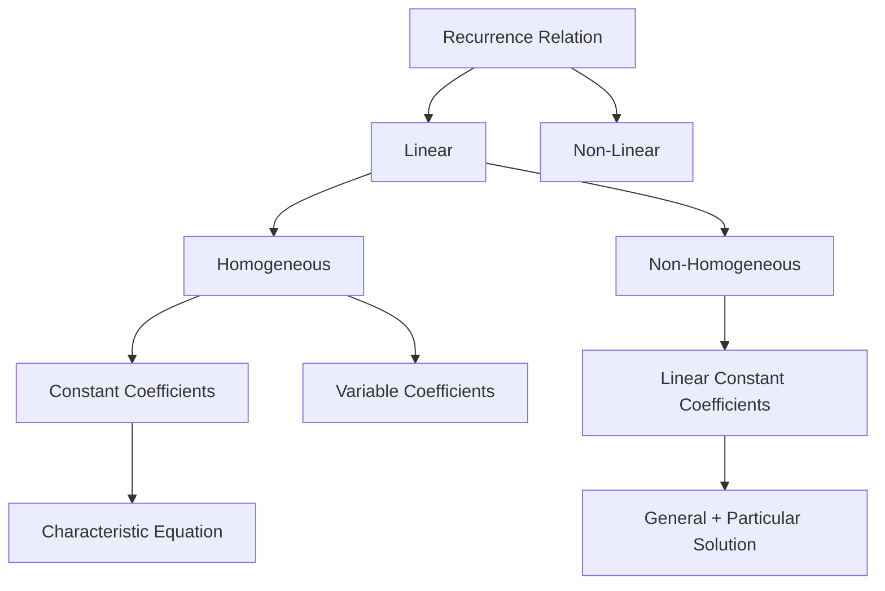
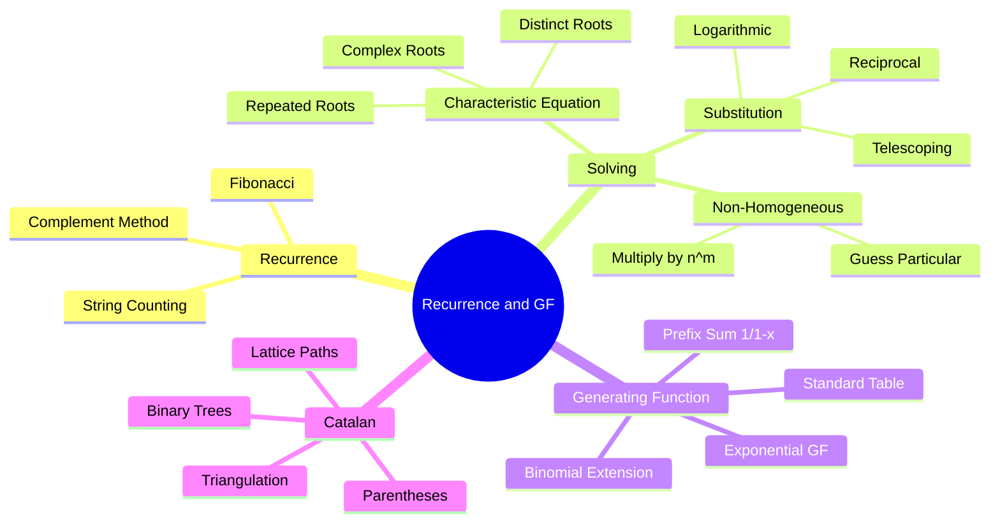
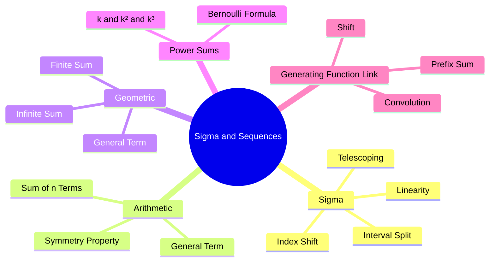

# 📘 جزوه خلاصه کنکور — ریاضیات گسسته

## فصل: روابط بازگشتی و تابع مولد

---

## ۱. روابط بازگشتی (Recurrence Relations)

> [!abstract] تعریف
> رابطه‌ای که جمله $n$-ام دنباله را بر اساس یک یا چند جمله قبلی بیان می‌کند.
> $$a_n = f(a_{n-1}, a_{n-2}, \dots)$$

### 🎯 الگوهای شمارش کلاسیک (با کلمات کلیدی)

| مسئله | رابطه بازگشتی | شرط اولیه |
|---|---|---|
| رشته باینری **شامل** ۰۰ | $a_n = a_{n-1} + a_{n-2} + 2^{n-2}$ | $a_1=0,\ a_2=1$ |
| رشته باینری **فاقد** ۰۰ | $a_n = a_{n-1} + a_{n-2}$ (فیبوناچی!) | $a_1=2,\ a_2=3$ |
| رشته باینری فاقد ۰۰ **که با ۰ شروع نشود** | با حالت‌بندی | — |
| جایگشت‌های بدون نقطه ثابت (Derangement) | $D_n = (n-1)(D_{n-1}+D_{n-2})$ | $D_1=0, D_2=1$ |
| تعداد پله‌های راه‌پله (۱ یا ۲ قدم) | $a_n = a_{n-1}+a_{n-2}$ | $a_1=1, a_2=2$ |
| برج هانوی | $H_n = 2H_{n-1}+1$ | $H_1=1$ |
| تعداد افرازهای عدد n | $p(n)$ — جدول | — |

> [!tip] ترفند تشخیص «شامل» از «فاقد»
> - **فاقد الگو** → معمولاً همگن خطی با ضرایب ثابت (فیبوناچی‌گونه)
> - **شامل الگو** → جملات ناهمگن (توان ۲ و ...) ظاهر می‌شود.
> - برای «شامل ۰۰» از **متمم** استفاده کن: کل رشته‌ها $2^n$ منهای فاقد ۰۰.

---

## ۲. حل روابط بازگشتی

### 🌳 دسته‌بندی روابط بازگشتی

---

### ۲.۱ روش معادله مشخصه (همگن خطی با ضرایب ثابت)

> [!info] گام‌ها
> ۱) رابطه را به فرم $a_n - c_1a_{n-1} - \dots - c_ka_{n-k}=0$ بنویس.
> ۲) معادله مشخصه: $r^k - c_1r^{k-1} - \dots - c_k = 0$
> ۳) ریشه‌ها را پیدا کن → فرم جواب عمومی بر اساس نوع ریشه.

#### 📌 حالت‌های ریشه معادله مشخصه

| نوع ریشه | فرم جواب عمومی |
|---|---|
| **دو ریشه حقیقی متمایز** $r_1 \ne r_2$ | $a_n = A r_1^n + B r_2^n$ |
| **ریشه مضاعف** $r$ (تکرار $m$) | $a_n = (A_0 + A_1n + \dots + A_{m-1}n^{m-1})r^n$ |
| **ریشه‌های مختلط** $r = \rho(\cos\theta \pm i\sin\theta)$ | $a_n = \rho^n(A\cos n\theta + B\sin n\theta)$ |
| **ریشه مختلط روی دایره واحد** $\rho=1$ | $a_n = A\cos n\theta + B\sin n\theta$ |

> [!tip] ترفند ریشه مختلط
> اگر معادله مشخصه $r^2 + pr + q=0$ داشته باشیم:
> - $\Delta = p^2-4q < 0$ → ریشه مختلط
> - $\rho = \sqrt{q}$ و $\cos\theta = \dfrac{-p}{2\sqrt{q}}$
> - برای محاسبه $r^n = \rho^n(\cos n\theta \pm i\sin n\theta)$

---

### ۲.۲ حل روابط ناهمگن خطی با ضرایب ثابت

> [!note] ساختار جواب
> $$a_n = a_n^{(h)} + a_n^{(p)}$$
> - $a_n^{(h)}$: جواب عمومی همگن متناظر
> - $a_n^{(p)}$: یک جواب خصوصی از رابطه ناهمگن

#### روش ۱ — وقتی جمله ناهمگن $b_n$ به شکل نمایی/چندجمله‌ای است

| شکل $b_n$ (جمله ناهمگن) | شکل جواب خصوصی پیشنهادی |
|---|---|
| $c$ (ثابت) | $A$ |
| $c\cdot d^n$ | $A d^n$ (اگر $d$ ریشه مشخصه نباشد) |
| $c\cdot d^n$ و $d$ ریشه با تکرار $m$ | $A n^m d^n$ |
| چندجمله‌ای درجه $k$ | چندجمله‌ای درجه $k$ |
| $c\cdot d^n \cdot P(n)$ | $d^n \cdot Q(n)$ با درجه $P$ |

> [!warning] نکته طلایی
> اگر شکل پیشنهادی جواب خصوصی **با جواب همگن همپوشانی** داشته باشد، آن را در $n^m$ ضرب کن ($m$ = مرتبه تکرار ریشه).

#### روش ۲ — جواب عمومی + جواب خصوصی

---

### ۲.۳ حل با تغییر متغیر (برای روابط غیرخطی)

> [!tip] الگوهای تکرارشونده تغییر متغیر

| شکل رابطه | تغییر متغیر | تبدیل به |
|---|---|---|
| $a_n = c\cdot a_{n-1}^2$ | $b_n = \log a_n$ | خطی: $b_n = 2b_{n-1}+\log c$ |
| $a_n = a_{n-1} + f(n)$ | $b_n = a_n - a_{n-1}$ یا جمع تلسکوپی | — |
| $a_n = \dfrac{a_{n-1}}{1+a_{n-1}}$ | $b_n = \dfrac{1}{a_n}$ | $b_n = b_{n-1}+1$ |
| $a_n = \dfrac{2a_{n-1}}{1+a_{n-1}}$ | $b_n = \dfrac{1}{a_n}$ | خطی |
| $a_n = a_{n-1}+n$ | $b_n = a_n$ با جمع تلسکوپی | $\sum$ |
| $a_n = n\cdot a_{n-1}$ | $b_n = \dfrac{a_n}{n!}$ یا $a_n = n!$ | — |
| $a_n = a_{n-1}\cdot a_{n-2}$ | $b_n = \log a_n$ | فیبوناچی |

> [!success] تکنیک جمع تلسکوپی
> اگر $a_n - a_{n-1} = f(n)$، آنگاه $a_n = a_0 + \sum_{k=1}^{n} f(k)$
> و $\sum_{k=1}^n k = \dfrac{n(n+1)}{2}$، $\sum k^2 = \dfrac{n(n+1)(2n+1)}{6}$

---

## ۳. تابع مولد (Generating Function)

> [!abstract] تعریف
> برای دنباله $\{a_n\}$:
> $$G(x) = \sum_{n=0}^{\infty} a_n x^n$$
> ضریب $x^n$ در $G(x)$ همان $a_n$ است.

### ۳.۱ یادآوری ترکیب برای اعداد منفی (تعمیم)

$$\binom{-n}{k} = (-1)^k \binom{n+k-1}{k} = (-1)^k \binom{n+k-1}{n-1}$$

> [!example] مثال
> $\dbinom{-3}{2} = (-1)^2\dbinom{4}{2} = 6$

---

### ۳.۲ تعمیم بسط دوجمله‌ای

$$\frac{1}{(1-x)^k} = \sum_{n=0}^{\infty} \binom{n+k-1}{k-1} x^n = \sum_{n=0}^{\infty}\binom{n+k-1}{n}x^n$$

$$\frac{1}{(1+x)^k} = \sum_{n=0}^{\infty} (-1)^n \binom{n+k-1}{k-1} x^n$$

> [!warning] دقت در علامت $(-1)^n$
> - مخرج $(1-x)^k$ → همه ضرایب **مثبت**
> - مخرج $(1+x)^k$ → ضرایب با علامت **متناوب** $(-1)^n$

---

### ۳.۳ 📊 جدول جامع الگوهای پایه توابع مولد

| #   | Series Form                                          | Sequence                                  | Closed Form (GF)            | Combinatorial Interpretation                     |
| --- | ---------------------------------------------------- | ----------------------------------------- | --------------------------- | ------------------------------------------------ |
| 1   | $\sum_{n=0}^{\infty} x^n$                            | $1,1,1,1,\dots$                           | $\dfrac{1}{1-x}$            | Unlimited selection of one object type           |
| 2   | $\sum_{n=0}^{\infty} (-1)^n x^n$                     | $1,-1,1,-1,\dots$                         | $\dfrac{1}{1+x}$            | Same as 1 with alternating sign                  |
| 3   | $\sum_{n=0}^{\infty} c^n x^n$                        | $1,c,c^2,c^3,\dots$                       | $\dfrac{1}{1-cx}$           | Each object has $c$ independent states           |
| 4   | $\sum_{n=0}^{\infty} \binom{n+k-1}{k-1} x^n$         | $1,k,\binom{k+1}{2},\dots$                | $\dfrac{1}{(1-x)^k}$        | Distribute $n$ identical into $k$ distinct boxes |
| 5   | $\sum_{n=0}^{\infty} n x^n$                          | $0,1,2,3,\dots$                           | $\dfrac{x}{(1-x)^2}$        | Weighted selection                               |
| 6   | $\sum_{n=0}^{\infty} (n+1)x^n$                       | $1,2,3,4,\dots$                           | $\dfrac{1}{(1-x)^2}$        | Shifted version of 5                             |
| 7   | $\sum_{n=0}^{\infty} \binom{n}{2} x^n$               | $0,0,1,3,6,\dots$                         | $\dfrac{x^2}{(1-x)^3}$      | Choosing 2 from $n$                              |
| 8   | $\sum_{n=0}^{N} x^n$                                 | $1,\dots,1,0,0,\dots$                     | $\dfrac{1-x^{N+1}}{1-x}$    | Choose 0 to $N$ from one type                    |
| 9   | $\sum_{n=0}^{\infty} \binom{N}{n} x^n$               | $\binom{N}{0},\dots,\binom{N}{N},0,\dots$ | $(1+x)^N$                   | Subset of $N$ distinct objects                   |
| 10  | $\sum_{n=0}^{\infty} \binom{N+n-1}{n} x^n$           | $\binom{N-1}{0},\binom{N}{1},\dots$       | $\dfrac{1}{(1-x)^N}$        | Combination with repetition                      |
| 11  | $\sum_{n=0}^{\infty} \binom{2n}{n} x^n$              | $1,2,6,20,70,\dots$                       | $\dfrac{1}{\sqrt{1-4x}}$    | Central binomial (lattice paths)                 |
| 12  | $\sum_{n=0}^{\infty} \frac{x^n}{n!}$                 | $1,1,\frac12,\frac16,\dots$               | $e^x$                       | EGF — permutations                               |
| 13  | $\sum_{n=0}^{\infty} F_n x^n$                        | $0,1,1,2,3,5,\dots$                       | $\dfrac{x}{1-x-x^2}$        | Fibonacci                                        |
| 14  | $\sum_{n=0}^{\infty} F_{n+1} x^n$                    | $1,1,2,3,5,\dots$                         | $\dfrac{1}{1-x-x^2}$        | Shifted Fibonacci                                |
| 15  | $\sum_{n=0}^{\infty} \frac{1}{n+1}\binom{2n}{n} x^n$ | $1,1,2,5,14,\dots$                        | $\dfrac{1-\sqrt{1-4x}}{2x}$ | Catalan numbers                                  |
| 16  | $\sum_{n=0}^{\infty} n!\,x^n$                        | $1,1,2,6,24,\dots$                        | No closed form              | Permutations (divergent)                         |
| 17  | $\sum_{n=0}^{\infty} D_n \frac{x^n}{n!}$             | $1,0,1,2,9,\dots$                         | $\dfrac{e^{-x}}{1-x}$       | Derangements (EGF)                               |

> [!tip] ترفندهای سریع
> - اگر $a_n$ چندجمله‌ای درجه $k$ باشد، مخرج توان $(1-x)^{k+1}$ می‌گیرد.
> - ضرب در $x^m$ → **شیفت** دنباله به راست (جملات اول صفر می‌شوند).
> - $x G'(x)$ → دنباله $\{n\cdot a_n\}$

---

### ۳.۴ تکنیک تبدیل به تابع مولد جمع دنباله‌ها

> [!note] جمع تجمعی (Prefix Sum)
> اگر $G(x)$ مولد $\{a_n\}$ باشد و $s_n = a_0+a_1+\dots+a_n$، آنگاه:
> $$S(x) = \frac{G(x)}{1-x}$$
> ✅ بله، ضرب در $\dfrac{1}{1-x}$ همان جمع دنباله است.
>
> و برای جمع دوبار: $\dfrac{G(x)}{(1-x)^2}$

---

### ۳.۵ 🔍 جدول استخراج ضریب (Coefficient Extraction)

| Expression | Coefficient of $x^n$ | Note |
|---|---|---|
| $\dfrac{1}{1-x}$ | $1$ | — |
| $\dfrac{1}{1-cx}$ | $c^n$ | — |
| $\dfrac{1}{(1-x)^k}$ | $\binom{n+k-1}{k-1}$ | Stars and bars |
| $\dfrac{x^m}{(1-x)^k}$ | $\binom{n-m+k-1}{k-1}$ if $n\ge m$, else $0$ | Shift |
| $\dfrac{1-x^N}{1-x}$ | $1$ if $0\le n\le N-1$, else $0$ | Finite series |
| $(1+x)^N$ | $\binom{N}{n}$ | Binomial theorem |
| $\dfrac{1}{(1-x)(1-y)}$ | Coeff of $x^a y^b$ is $1$ | Two variables |
| $\dfrac{1}{1-x-x^2}$ | $F_{n+1}$ | Fibonacci |

> [!tip] Golden rule
> For expressions like $\dfrac{(1-x^4)^3}{(1-x)^3}$, expand the numerator via binomial theorem and multiply each term by the table above. Keep only terms with exponent $\le n$.

---

### ۳.۶ 🎯 جدول انتخاب روش

| Problem Indicator | Suggested Method |
|---|---|
| Few variables ($\le 4$) and small bounds | Inclusion-Exclusion (faster) |
| Many variables or irregular bounds | Generating Functions |
| Independent choices (multiplicative) | Generating Functions (multiply expansions) |
| Linear recurrence with constant coefficients | Generating Functions (closed form) |
| "At least / at most" with many constraints | Inclusion-Exclusion |
| "Exactly $k$" or "at most $k$" | Generating Functions (patterns 8, 9) |
| Path counting or recursive structures | Generating Functions (patterns 11, 13, 15) |
| Order matters (permutations) | EGF (patterns 12, 16, 17) |

---

### ۳.۷ 💡 مثال کاربردی — ترکیب جدول‌ها

**Problem:** Number of solutions to $x_1+x_2+x_3=10$ with $0\le x_i\le 4$.

**Step 1 — Interpretation:** Distribute 10 identical objects into 3 boxes with capacity 4.

**Step 2 — Pattern:** Each variable uses pattern 8 → $\dfrac{1-x^5}{1-x}$.

**Step 3 — Generating Function:**
$$\left(\frac{1-x^5}{1-x}\right)^3 = \frac{(1-x^5)^3}{(1-x)^3}$$

**Step 4 — Coefficient Extraction:**
Numerator $= 1 - 3x^5 + 3x^{10} - x^{15}$. Coefficient of $x^{10}$:
- $1\cdot\dbinom{10+2}{2} = 66$
- $-3x^5\cdot\dbinom{5+2}{2} = -63$
- $3x^{10}\cdot\dbinom{0+2}{2} = 3$
- **Total: $66-63+3=6$**

**Step 5 — Verify with Inclusion-Exclusion:**
$\dbinom{12}{2}-3\dbinom{7}{2}+3\dbinom{2}{2} = 66-63+3 = 6$ ✅

---

### ۳.۸ 🧩 ترفندهای پیشرفته تابع مولد

> [!tip] Partial Fractions Method
> To find the coefficient of $\dfrac{P(x)}{Q(x)}$ where $\deg P < \deg Q$:
> 1. Factor $Q(x)$ into linear/quadratic factors.
> 2. Decompose into $\dfrac{A}{1-rx}$ forms.
> 3. Coefficient of $x^n$ is $\sum A_i r_i^n$.
>
> Example: $\dfrac{1}{1-x-x^2} = \dfrac{A}{1-\phi x}+\dfrac{B}{1-\psi x}$ where $\phi,\psi$ are roots of $r^2=r+1$.

> [!tip] Product of GFs = Convolution
> If $G(x)$ generates $\{a_n\}$ and $H(x)$ generates $\{b_n\}$, then $G(x)H(x)$ generates:
> $$c_n = \sum_{k=0}^{n} a_k b_{n-k}$$
> This is the **convolution** — key for counting composite structures.

> [!tip] Derivative Trick
> If $G(x) = \sum a_n x^n$, then:
> - $xG'(x) = \sum n\,a_n x^n$
> - $xG'(x)+G(x) = \sum (n+1)a_n x^n$
> - $G'(x) = \sum (n+1)a_{n+1} x^n$

> [!tip] Catalan GF Derivation
> From $C_n = \sum_{i=0}^{n-1} C_i C_{n-1-i}$:
> $$C(x) = 1 + x\,C(x)^2 \Rightarrow C(x) = \frac{1-\sqrt{1-4x}}{2x}$$

---

## ۴. مولد نمایی (Exponential Generating Function)

$$E(x) = \sum_{n=0}^{\infty} a_n \frac{x^n}{n!}$$

> [!info] کاربرد
> مناسب برای **مسائل جایگشتی** (ترتیب مهم است)، مثل توزیع اشیای متمایز.

| دنباله | مولد نمایی |
|---|---|
| $a_n = 1$ | $e^x$ |
| $a_n = n$ | $xe^x$ |
| $a_n = n!$ | $\dfrac{1}{1-x}$ |
| $a_n = \dbinom{n}{k}$ | $\dfrac{e^x x^k}{k!}$ |
| $a_n = a^n$ | $e^{ax}$ |

> [!tip] تفاوت کلیدی
> - **مولد معمولی** → ترکیب‌ها، توزیع اشیای یکسان
> - **مولد نمایی** → جایگشت‌ها، توزیع اشیای متمایز

---

## ۵. عدد کاتالان (Catalan Number)

$$C_n = \frac{1}{n+1}\binom{2n}{n} = \binom{2n}{n} - \binom{2n}{n+1}$$

رابطه بازگشتی: $C_n = \sum_{i=0}^{n-1} C_i C_{n-i}$

اولین جملات: $1, 1, 2, 5, 14, 42, 132, \dots$

### 🎯 یوزکیس‌های عدد کاتالان

**۱. مسیر در مربع شطرنجی ($n\times n$)**
تعداد مسیرها از $(0,0)$ به $(n,n)$ با $n$ حرکت راست و $n$ حرکت بالا، به‌طوری که هرگز از قطر عبور نکنیم. برابر $C_n$.

**۲. قضیه باینری (شرط پیشوند)**
دنباله‌های دودویی با $n$ صفر و $n$ یک که در هیچ پیشوندی تعداد یک‌ها از صفرها بیشتر نباشد. برابر $C_n$. تعمیم: اگر $m$ صفر و $n$ یک داشته باشیم ($m\ge n$)، تعداد مسیرهای معتبر برابر $\dbinom{m+n}{n}-\dbinom{m+n}{n-1}$.

**۳. پرانتزگذاری معتبر**
تعداد روش‌های قرار دادن پرانتز معتبر برای $n$ جفت پرانتز، یا پرانتزگذاری $n+1$ عامل در ضرب. برابر $C_n$.

**۴. ترتیب ضرب ماتریس‌ها**
تعداد ترتیب‌های ممکن برای ضرب زنجیره‌ای $n+1$ ماتریس (بدون تغییر ترتیب). برابر $C_n$.

**۵. وترهای غیرمتقاطع روی دایره**
$n$ وتر غیرمتقاطع با $2n$ نقطه روی محیط دایره. برابر $C_n$.

**۶. مثلث‌بندی چندضلعی محدب**
تعداد روش‌های مثلث‌بندی یک $(n+2)$-ضلعی محدب با قطرهای غیرمتقاطع. برابر $C_n$.

**۷. درخت‌های باینری با $n$ گره**
تعداد درخت‌های باینری (کامل و ناکامل) با $n$ گره. برابر $C_n$.

**۸. ترتیب‌های معتبر پشته (Stack)**
تعداد دنباله‌های push/pop معتبر با $n$ عمل. برابر $C_n$.

**۹. حلقه‌های تو در تو / پرانتزهای متوازن**
$n$ جفت پرانتز متوازن. برابر $C_n$.

**۱۰. Mountain Ranges**
مسیر با $n$ گام بالا و $n$ گام پایین که هرگز زیر محور نرود. برابر $C_n$.

**۱۱. توابع صعودی بین دو مجموعه** ⚠️
تعداد توابع اکیداً صعودی از $A$ (اندازه $n$) به $B$ (اندازه $m$) برابر $\dbinom{m}{n}$ است، **نه کاتالان**. اگر شرط عدم عبور از حد اضافه شود، کاتالان ظاهر می‌شود.

**۱۲. هرم $n$ سکه**
چیدمان هرمی $n$ سکه در حالت خاص به کاتالان مرتبط است.

> [!warning] ترفند تشخیص
> هر مسئله‌ای با ساختار «**ترتیب معتبر**» و شرط «**هرگز از یک حد جلو نزنیم**» → کاتالان.
> فرمول سریع: $C_n = \dfrac{(2n)!}{n!(n+1)!}$

---

## 🧠 جمع‌بندی ترفندهای کنکوری

> [!success] چک‌لیست نهایی
> - [ ] شرایط اولیه را همیشه چک کن (اندیس از ۰ یا ۱؟)
> - [ ] در ناهمگن، همپوشانی جواب خصوصی با همگن را بررسی کن
> - [ ] علامت $(-1)^n$ در $(1+x)^k$ را فراموش نکن
> - [ ] کاتالان vs ترکیب ساده را تشخیص بده
> - [ ] مولد نمایی برای جایگشت، معمولی برای ترکیب

---

# 📐 نوت کمکی — سیگما و دنباله‌های پایه

> [!abstract] کاربرد در این فصل
> این نوت پیش‌نیاز حل روابط بازگشتی، جمع تلسکوپی، و محاسبه ضرایب تابع مولد است.

---

## ۱. نماد سیگما (Σ)

$$\sum_{k=m}^{n} a_k = a_m + a_{m+1} + \dots + a_n$$

### 📏 قوانین پایه

| قانون | فرمول |
|---|---|
| **خطی بودن** | $\sum (c\,a_k + d\,b_k) = c\sum a_k + d\sum b_k$ |
| **ثابت** | $\sum_{k=1}^{n} c = n\cdot c$ |
| **تفکیک بازه** | $\sum_{k=1}^{n} = \sum_{k=1}^{m} + \sum_{k=m+1}^{n}$ |
| **شیفت اندیس** | $\sum_{k=1}^{n} a_k = \sum_{k=0}^{n-1} a_{k+1}$ |
| **معکوس کردن** | $\sum_{k=1}^{n} a_k = \sum_{k=1}^{n} a_{n+1-k}$ |
| **ضرب ثابت در اندیس** | $\sum_{k=1}^{n} a_{ck}$ (بازه را دقت کن) |

> [!warning] نکته شیفت اندیس
> وقتی اندیس را جابه‌جا می‌کنی، **حدود** و **جمله عمومی** باید هماهنگ تغییر کنند:
> $$\sum_{k=0}^{n} a_k = \sum_{k=1}^{n+1} a_{k-1}$$

---

## ۲. 📊 جدول جمع‌های مهم (حتماً حفظ شود)

| جمع | نتیجه |
|---|---|
| $\sum_{k=1}^{n} k$ | $\dfrac{n(n+1)}{2}$ |
| $\sum_{k=1}^{n} k^2$ | $\dfrac{n(n+1)(2n+1)}{6}$ |
| $\sum_{k=1}^{n} k^3$ | $\left[\dfrac{n(n+1)}{2}\right]^2$ |
| $\sum_{k=1}^{n} k^4$ | $\dfrac{n(n+1)(2n+1)(3n^2+3n-1)}{30}$ |
| $\sum_{k=0}^{n} r^k$ (هندسی) | $\dfrac{1-r^{n+1}}{1-r},\ r\ne1$ |
| $\sum_{k=0}^{\infty} r^k$، $\|r\|<1$ | $\dfrac{1}{1-r}$ |
| $\sum_{k=1}^{n} \dfrac{1}{k(k+1)}$ | $1 - \dfrac{1}{n+1}$ (تلسکوپی) |
| $\sum_{k=0}^{n} \binom{n}{k}$ | $2^n$ |
| $\sum_{k=0}^{n} k\binom{n}{k}$ | $n\cdot 2^{n-1}$ |
| $\sum_{k=0}^{n} \binom{n}{k}^2$ | $\binom{2n}{n}$ |

> [!tip] ترفند جمع تلسکوپی
> اگر جمله را به شکل $f(k)-f(k+1)$ یا $f(k+1)-f(k)$ بنویسی:
> $$\sum_{k=1}^{n}\big(f(k)-f(k+1)\big) = f(1)-f(n+1)$$
> مثال: $\dfrac{1}{k(k+1)} = \dfrac{1}{k}-\dfrac{1}{k+1}$

---

## ۳. دنباله حسابی (Arithmetic)

$$a_n = a_1 + (n-1)d$$

| کمیت | فرمول |
|---|---|
| جمله عمومی | $a_n = a_1+(n-1)d$ |
| مجموع $n$ جمله | $S_n = \dfrac{n}{2}(a_1+a_n) = \dfrac{n}{2}\big(2a_1+(n-1)d\big)$ |
| رابطه بازگشتی | $a_n = a_{n-1}+d$ |
| تابع مولد | $\dfrac{a_1 + (d-a_1)x}{(1-x)^2}$ |

> [!tip] خاصیت
> $a_m + a_n = a_p + a_q$ اگر $m+n=p+q$

---

## ۴. دنباله هندسی (Geometric)

$$a_n = a_1\, r^{n-1}$$

| کمیت | فرمول |
|---|---|
| جمله عمومی | $a_n = a_1 r^{n-1}$ |
| مجموع $n$ جمله | $S_n = a_1\dfrac{r^n-1}{r-1} = a_1\dfrac{1-r^n}{1-r}$، $r\ne1$ |
| مجموع بی‌نهایت ($\|r\|<1$) | $S = \dfrac{a_1}{1-r}$ |
| رابطه بازگشتی | $a_n = r\,a_{n-1}$ |
| تابع مولد | $\dfrac{a_1}{1-rx}$ |

> [!tip] خاصیت
> $a_m \cdot a_n = a_p \cdot a_q$ اگر $m+n=p+q$
> و $a_n^2 = a_{n-k}\cdot a_{n+k}$ (وسط هندسی)

---

## ۵. دنباله‌های خاص دیگر

### 🔹 دنباله فیبوناچی
$$F_n = F_{n-1}+F_{n-2},\quad F_0=0,\ F_1=1$$
$$F_n = \frac{1}{\sqrt5}\left[\left(\frac{1+\sqrt5}{2}\right)^n - \left(\frac{1-\sqrt5}{2}\right)^n\right]$$

### 🔹 دنباله هارمونیک
$$a_n = \frac{1}{n} \quad (\text{همگرا نیست})$$
$$\sum_{k=1}^{n}\frac{1}{k} \approx \ln n + \gamma$$

### 🔹 دنباله توانی
$$a_n = n^k \Rightarrow \text{مولد: مخرج }(1-x)^{k+1}$$

### 🔹 دنباله بازگشتی خطی مرتبه دوم (عمومی)
$$a_n = p\,a_{n-1}+q\,a_{n-2}$$
معادله مشخصه: $r^2-pr-q=0$

---

## ۶. 🔗 ارتباط با تابع مولد (نکات کلیدی)

> [!note] تبدیل دنباله به مولد
> | عمل روی دنباله | اثر روی مولد |
> |---|---|
> | $a_{n+1}$ (شیفت چپ) | $\dfrac{G(x)-a_0}{x}$ |
> | $a_{n-1}$ (شیفت راست) | $x\,G(x)$ |
> | $n\,a_n$ | $x\,G'(x)$ |
> | $a_n + b_n$ | $G(x)+H(x)$ |
> | $\sum_{k=0}^{n} a_k$ | $\dfrac{G(x)}{1-x}$ |
> | $a_n\cdot b_n$ (کانولوشن) | $G(x)\cdot H(x)$ |

> [!success] ترفند حل رابطه بازگشتی با مولد
> ۱) رابطه را در $x^n$ ضرب و روی $n$ جمع کن
> ۲) $G(x)$ را بر حسب $x$ حل کن
> ۳) بسط کسری جزئی → ضریب $x^n$ را بخوان

---

## ۷. 🧮 جمع‌بندی ترفندهای محاسباتی

> [!tip] چک‌لیست سریع
> - [ ] حدود سیگما را همیشه چک کن (از ۰ یا ۱؟)
> - [ ] برای تلسکوپی، تجزیه کسری جزئی بزن
> - [ ] در هندسی، شرط $\|r\|<1$ برای بی‌نهایت
> - [ ] جمع $n a_n$ با مشتق مولد سریع‌تر است
> - [ ] فرمول $\sum k^2$ و $\sum k^3$ را حفظ کن (پرتکرار در کنکور)