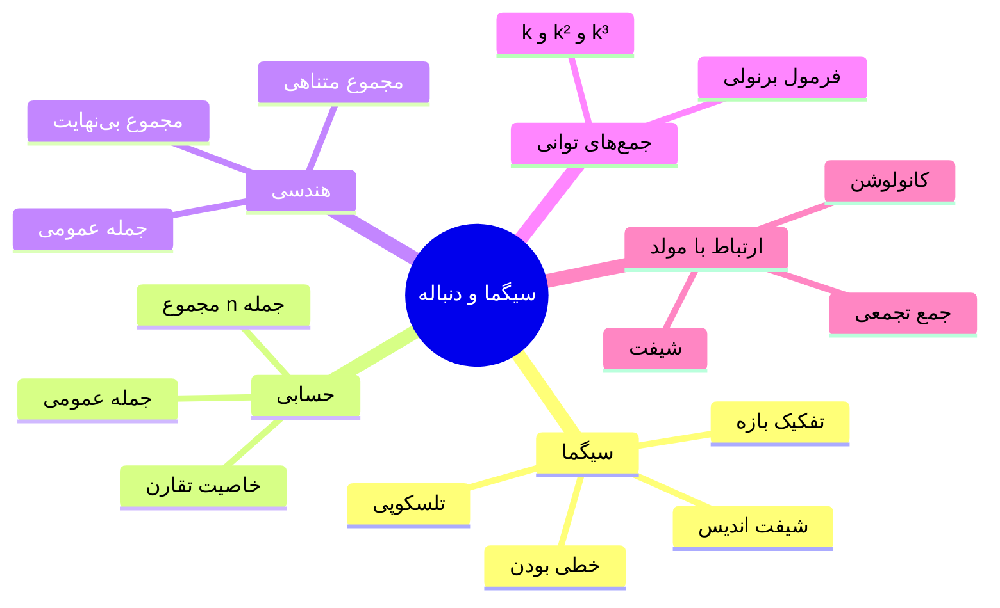

# 📐 نوت کمکی — سیگما و دنباله‌های پایه

> [!abstract] کاربرد در این فصل
> این نوت پیش‌نیاز حل روابط بازگشتی، جمع تلسکوپی، و محاسبه ضرایب تابع مولد است.

---

## ۱. نماد سیگما (Σ)

$$\sum_{k=m}^{n} a_k = a_m + a_{m+1} + \dots + a_n$$

### 📏 قوانین پایه

| قانون | فرمول |
|---|---|
| **خطی بودن** | $\sum $c\,a_k + d\,b_k$ = c\sum a_k + d\sum b_k$ |
| **ثابت** | $\sum_{k=1}^{n} c = n\cdot c$ |
| **تفکیک بازه** | $\sum_{k=1}^{n} = \sum_{k=1}^{m} + \sum_{k=m+1}^{n}$ |
| **شیفت اندیس** | $\sum_{k=1}^{n} a_k = \sum_{k=0}^{n-1} a_{k+1}$ |
| **معکوس کردن** | $\sum_{k=1}^{n} a_k = \sum_{k=1}^{n} a_{n+1-k}$ |
| **ضرب ثابت در اندیس** | $\sum_{k=1}^{n} a_{ck}$ (بازه را دقت کن) |

> [!warning] نکته شیفت اندیس
> وقتی اندیس را جابه‌جا می‌کنی، **حدود** و **جمله عمومی** باید هماهنگ تغییر کنند:
> $$\sum_{k=0}^{n} a_k = \sum_{k=1}^{n+1} a_{k-1}$$

---

## ۲. 📊 جدول جمع‌های مهم (حتماً حفظ شود)

| جمع | نتیجه |
|---|---|
| $\sum_{k=1}^{n} k$ | $\dfrac{n(n+1)}{2}$ |
| $\sum_{k=1}^{n} k^2$ | $\dfrac{n(n+1)(2n+1)}{6}$ |
| $\sum_{k=1}^{n} k^3$ | $\left[\dfrac{n(n+1)}{2}\right]^2$ |
| $\sum_{k=1}^{n} k^4$ | $\dfrac{n(n+1)(2n+1)(3n^2+3n-1)}{30}$ |
| $\sum_{k=0}^{n} r^k$ (هندسی) | $\dfrac{1-r^{n+1}}{1-r},\ r\ne1$ |
| $\sum_{k=0}^{\infty} r^k$، $\|r\|<1$ | $\dfrac{1}{1-r}$ |
| $\sum_{k=1}^{n} \dfrac{1}{k(k+1)}$ | $1 - \dfrac{1}{n+1}$ (تلسکوپی) |
| $\sum_{k=0}^{n} \binom{n}{k}$ | $2^n$ |
| $\sum_{k=0}^{n} k\binom{n}{k}$ | $n\cdot 2^{n-1}$ |
| $\sum_{k=0}^{n} \binom{n}{k}^2$ | $\binom{2n}{n}$ |

> [!tip] ترفند جمع تلسکوپی
> اگر جمله را به شکل $f(k)-f(k+1)$ یا $f(k+1)-f(k)$ بنویسی:
> $$\sum_{k=1}^{n}\big(f(k)-f(k+1)\big) = f(1)-f(n+1)$$
> مثال: $\dfrac{1}{k(k+1)} = \dfrac{1}{k}-\dfrac{1}{k+1}$

---

## ۳. دنباله حسابی (Arithmetic)

$$a_n = a_1 + (n-1)d$$

| کمیت | فرمول |
|---|---|
| جمله عمومی | $a_n = a_1+(n-1)d$ |
| مجموع $n$ جمله | $S_n = \dfrac{n}{2}(a_1+a_n) = \dfrac{n}{2}\big(2a_1+(n-1)d\big)$ |
| رابطه بازگشتی | $a_n = a_{n-1}+d$ |
| تابع مولد | $\dfrac{a_1 + (d-a_1)x}{(1-x)^2}$ |

> [!tip] خاصیت
> $a_m + a_n = a_p + a_q$ اگر $m+n=p+q$

---

## ۴. دنباله هندسی (Geometric)

$$a_n = a_1\, r^{n-1}$$

| کمیت | فرمول |
|---|---|
| جمله عمومی | $a_n = a_1 r^{n-1}$ |
| مجموع $n$ جمله | $S_n = a_1\dfrac{r^n-1}{r-1} = a_1\dfrac{1-r^n}{1-r}$، $r\ne1$ |
| مجموع بی‌نهایت $$\|r\|<1$$ | $S = \dfrac{a_1}{1-r}$ |
| رابطه بازگشتی | $a_n = r\,a_{n-1}$ |
| تابع مولد | $\dfrac{a_1}{1-rx}$ |

> [!tip] خاصیت
> $a_m \cdot a_n = a_p \cdot a_q$ اگر $m+n=p+q$
> و $a_n^2 = a_{n-k}\cdot a_{n+k}$ (وسط هندسی)

---

## ۵. دنباله‌های خاص دیگر

### 🔹 دنباله فیبوناچی
$$F_n = F_{n-1}+F_{n-2},\quad F_0=0,\ F_1=1$$
$$F_n = \frac{1}{\sqrt5}\left[\left(\frac{1+\sqrt5}{2}\right)^n - \left(\frac{1-\sqrt5}{2}\right)^n\right]$$

### 🔹 دنباله هارمونیک
$$a_n = \frac{1}{n} \quad (\text{همگرا نیست})$$
$$\sum_{k=1}^{n}\frac{1}{k} \approx \ln n + \gamma$$

### 🔹 دنباله توانی
$$a_n = n^k \Rightarrow \text{مولد: مخرج }(1-x)^{k+1}$$

### 🔹 دنباله بازگشتی خطی مرتبه دوم (عمومی)
$$a_n = p\,a_{n-1}+q\,a_{n-2}$$
معادله مشخصه: $r^2-pr-q=0$

---

## ۶. 🔗 ارتباط با تابع مولد (نکات کلیدی)

> [!note] تبدیل دنباله به مولد
> | عمل روی دنباله | اثر روی مولد |
> |---|---|
> | $a_{n+1}$ (شیفت چپ) | $\dfrac{G(x)-a_0}{x}$ |
> | $a_{n-1}$ (شیفت راست) | $x\,G(x)$ |
> | $n\,a_n$ | $x\,G'(x)$ |
> | $a_n + b_n$ | $G(x)+H(x)$ |
> | $\sum_{k=0}^{n} a_k$ | $\dfrac{G(x)}{1-x}$ |
> | $a_n\cdot b_n$ (کانولوشن) | $G(x)\cdot H(x)$ |

> [!success] ترفند حل رابطه بازگشتی با مولد
> ۱) رابطه را در $x^n$ ضرب و روی $n$ جمع کن
> ۲) $G(x)$ را بر حسب $x$ حل کن
> ۳) بسط کسری جزئی → ضریب $x^n$ را بخوان

---

## ۷. 🧮 جمع‌بندی ترفندهای محاسباتی

> [!tip] چک‌لیست سریع
> - [ ] حدود سیگما را همیشه چک کن (از ۰ یا ۱؟)
> - [ ] برای تلسکوپی، تجزیه کسری جزئی بزن
> - [ ] در هندسی، شرط $\|r\|<1$ برای بی‌نهایت
> - [ ] جمع $n a_n$ با مشتق مولد سریع‌تر است
> - [ ] فرمول $\sum k^2$ و $\sum k^3$ را حفظ کن (پرتکرار در کنکور)
