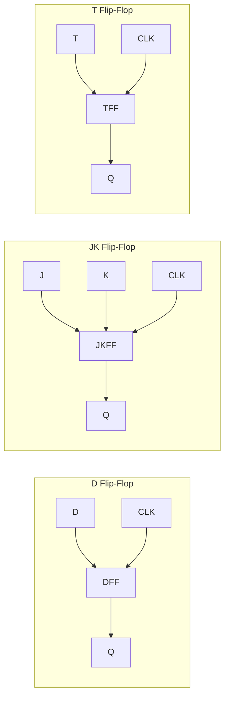
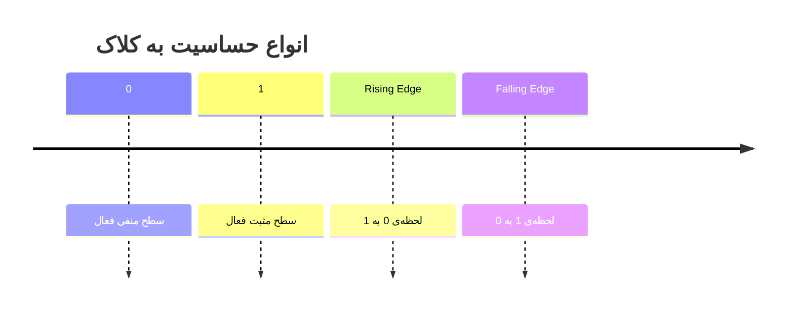

# 📘 جزوه کنکوری: مدارات ترتیبی و سنکرون

> [!info] نقشه کلی فصل
> این فصل دو بخش بزرگ داره: **بخش A) عناصر حافظه** (لچ، فلیپ‌فلاپ، کلاک، Master-Slave) و **بخش B) تحلیل و طراحی مدارات ترتیبی** (دیاگرام حالت، شمارنده، تقسیم فرکانس، شیفت‌رجیستر).

---

# بخش A: عناصر حافظه (Latches & Flip-Flops)

# 0️⃣ پایه

> [!note] مدار ترتیبی چیست؟
> مداری که خروجی‌اش به **ورودی فعلی** و **حالت قبلی (حافظه)** بستگی داره.
> $$Y = f(X, Q) \quad \text{که } Q \text{ حالت فعلی است}$$

> [!important] ==تفاوت لچ و فلیپ‌فلاپ==
> - **لچ (Latch)**: **سطح‌حساس** (Level-sensitive) — تا وقتی Enable=1 است، خروجی تابع ورودی است.
> - **فلیپ‌فلاپ (FF)**: **لبه‌حساس** (Edge-triggered) — فقط در لحظه‌ی لبه کلاک تغییر می‌کند.

---

# 1️⃣ لچ‌ها (Latches)

## 1.1 لچ SR با NOR

> [!note] دو جدول درستی!
> برای لچ SR **دو جدول** داریم:
> - **جدول درستی عادی**: خروجی بر اساس S و R در هر لحظه
> - **جدول حالت بعدی**: $Q^*$ (یا $Q_{next}$) بر اساس S، R و $Q$ فعلی

### جدول درستی عادی (NOR-based)

| S | R | Q | $\bar{Q}$ | وضعیت |
|---|---|---|-----------|-------|
| 0 | 0 | Q | $\bar{Q}$ | **حفظ (Hold)** |
| 0 | 1 | 0 | 1 | **Reset** |
| 1 | 0 | 1 | 0 | **Set** |
| 1 | 1 | 0 | 0 | **ممنوع (Invalid)** ⚠️ |

> [!danger] ==حالت ممنوع در لچ SR==
> $S=R=1$ در لچ NOR → هر دو خروجی ۰ می‌شن → نقض مکملی → **حالت نامعتبر**.

### جدول حالت بعدی ($Q^*$)

| S | R | $Q^*$ |
|---|---|-------|
| 0 | 0 | $Q$ |
| 0 | 1 | 0 |
| 1 | 0 | 1 |
| 1 | 1 | X (Don't care) |

### معادله مشخصه لچ SR

$$\boxed{Q^* = S + \bar{R}Q}$$

> [!tip] ==ترفند حفظ معادله==
> - اگه $S=1$ → $Q^*=1$ (Set)
> - اگه $R=1, S=0$ → $Q^*=0$ (Reset)
> - اگه $S=R=0$ → $Q^*=Q$ (Hold)
> شرط اعتبار: $S \cdot R = 0$

## 1.2 لچ SR با NAND (Active-Low)

> [!warning] ==تفاوت کلیدی==
> در نسخه NAND، ورودی‌ها **Active-Low** هستن: $\bar{S}$ و $\bar{R}$

| $\bar{S}$ | $\bar{R}$ | $Q^*$ | وضعیت |
|-----------|-----------|-------|-------|
| 0 | 0 | X | **ممنوع** ⚠️ |
| 0 | 1 | 1 | Set |
| 1 | 0 | 0 | Reset |
| 1 | 1 | $Q$ | Hold |

> [!important] ==نکته کنکوری==
> - NOR-based: حالت ممنوع $S=R=1$
> - NAND-based: حالت ممنوع $\bar{S}=\bar{R}=0$
> - ==در NAND، حالت Hold وقتیه که هر دو ورودی ۱ باشن== (برعکس NOR)

### معادله مشخصه لچ NAND-SR
$$Q^* = \bar{S} + R \cdot Q \quad \text{با شرط } \bar{S} \cdot R \neq 0$$

## 1.3 لچ D (Data Latch)

> [!note] ساده‌ترین لچ
> با اتصال $S=D$ و $R=\bar{D}$ به لچ SR ساخته می‌شه.

| D | EN | $Q^*$ |
|---|-----|-------|
| 0 | 1 | 0 |
| 1 | 1 | 1 |
| X | 0 | $Q$ |

$$Q^* = D \quad \text{(وقتی EN=1)}$$

---

# 2️⃣ فلیپ‌فلاپ‌ها (Flip-Flops)

## 2.1 D Flip-Flop (DFF)

> [!note] ساده‌ترین FF
> خروجی در لبه کلاک، مقدار D رو می‌گیره.

### جدول حالت بعدی
| D | $Q^*$ |
|---|-------|
| 0 | 0 |
| 1 | 1 |

### معادله مشخصه
$$\boxed{Q^* = D}$$

> [!tip] ==نکته DFF==
> - DFF = **تاخیر یک کلاک**
> - پرکاربردترین FF در طراحی
> - در FPGAها معمولاً فقط DFF موجوده

## 2.2 JK Flip-Flop (JKFF)

> [!note] انعطاف‌پذیرترین FF
> ترکیب SR + حالت Toggle

### جدول حالت بعدی
| J | K | $Q^*$ | عملکرد |
|---|---|-------|--------|
| 0 | 0 | $Q$ | Hold |
| 0 | 1 | 0 | Reset |
| 1 | 0 | 1 | Set |
| 1 | 1 | $\bar{Q}$ | **Toggle** |

### معادله مشخصه
$$\boxed{Q^* = J\bar{Q} + \bar{K}Q}$$

> [!tip] ==ترفند حفظ JKFF==
> - $J$ = Set، $K$ = Reset
> - هر دو ۱ → Toggle
> - هر دو ۰ → Hold
> - **حالت ممنوع نداره** ✅ (برخلاف SR)

## 2.3 T Flip-Flop (TFF)

> [!note] ساده‌ترین برای شمارنده
> T = Toggle

### جدول حالت بعدی
| T | $Q^*$ |
|---|-------|
| 0 | $Q$ |
| 1 | $\bar{Q}$ |

### معادله مشخصه
$$\boxed{Q^* = T \oplus Q}$$

> [!tip] ==ترفند: ساخت TFF از JKFF==
> کافیه $J = K = T$ باشه.
> $$Q^* = T\bar{Q} + \bar{T}Q = T \oplus Q \quad ✅$$

## 2.4 بلوک دیاگرام FFها



---

# 3️⃣ ساخت FFها با سایر FFها

> [!important] ==روش کلی==
> برای تبدیل FF نوع $X$ به نوع $Y$:
> 1. جدول حالت بعدی هدف ($Y$) را بنویس
> 2. برای هر حالت، ورودی‌های لازم $X$ را پیدا کن (با جدول تحریک/Excitation Table)
> 3. معادله ورودی‌های $X$ را بر حسب ورودی‌های $Y$ و $Q$ بنویس

## 3.1 جدول تحریک (Excitation Table)

| نوع FF | $Q \to Q^*$ | ورودی لازم |
|--------|------------|-----------|
| **D** | $0 \to 0$ | D=0 |
| | $0 \to 1$ | D=1 |
| | $1 \to 0$ | D=0 |
| | $1 \to 1$ | D=1 |
| **JK** | $0 \to 0$ | J=0, K=X |
| | $0 \to 1$ | J=1, K=X |
| | $1 \to 0$ | J=X, K=1 |
| | $1 \to 1$ | J=X, K=0 |
| **T** | $0 \to 0$ | T=0 |
| | $0 \to 1$ | T=1 |
| | $1 \to 0$ | T=1 |
| | $1 \to 1$ | T=0 |

## 3.2 ساخت TFF از DFF

> [!tip] ==ترفند==
> $$D = T \oplus Q$$
> کافیه یه XOR بین T و Q بذاری و به D بدهی.

## 3.3 ساخت DFF از TFF

$$T = D \oplus Q$$

## 3.4 ساخت JKFF از DFF

$$D = J\bar{Q} + \bar{K}Q$$

## 3.5 ساخت DFF از JKFF

$$J = D, \quad K = \bar{D}$$

## 3.6 ساخت JKFF از TFF

$$T = J\bar{Q} + KQ$$

## 3.7 ساخت TFF از JKFF

$$J = K = T$$

---

# 4️⃣ پالس‌های کلاک

> [!note] انواع حساسیت
> - **سطح مثبت (Positive Level)**: وقتی CLK=1، فعال
> - **سطح منفی (Negative Level)**: وقتی CLK=0، فعال
> - **لبه مثبت (Positive Edge)**: در لحظه‌ی $0 \to 1$
> - **لبه منفی (Negative Edge)**: در لحظه‌ی $1 \to 0$



---

# 5️⃣ روش‌های حساس به لبه کردن FFها

## 5.1 مدار تولید لبه (Edge Detector)

> [!note] ایده
> با ترکیب گیت‌های منطقی + تاخیر، یک پالس باریک در لبه تولید می‌شه.

```tikz
\usepackage{circuitikz}
\begin{document}
\begin{circuitikz}[american]
    \node[not port] (n1) at (0,0) {};
    \node[and port] (a1) at (2,0) {};
    \draw (n1.out) -- (a1.in 1);
    \draw (a1.out) -- ++(0.5,0) node[right]{Pulse};
\end{circuitikz}
\end{document}
```

## 5.2 فلیپ‌فلاپ Master-Slave

> [!important] ==ایده Master-Slave==
> - دو لچ پشت سر هم
> - **Master** با لبه/سطح اول فعال می‌شه
> - **Slave** با فاز دوم
> - نتیجه: خروجی فقط در **یک لبه** تغییر می‌کنه

![[Pasted image 20261103111054.png|700]]
> [!danger] ==نکته مهم Master-Slave==
> - در طول نیم‌سیکل اول، Master فعال و Slave غیرفعال
> - در طول نیم‌سیکل دوم، برعکس
> - نتیجه: خروجی در **لبه‌ی فعال** کلاک تغییر می‌کنه
> - در شکل بالا حساس به لبی منفی طراحی شده ، اگر گیت NOT رو به FF اول وصل کرده بودیم حساس به لبه مثبت میشد

## 5.3 FFهای لبه‌ای ذاتاً (True Edge-Triggered)

> [!note] FFهای لبه‌ای مدرن
> با ساختار داخلی خاص (مثل 6-ترانزیستوری) از ابتدا لبه‌ای هستن و نیازی به Master-Slave ندارن.
> مزیت: سرعت بالاتر، تاخیر کمتر.

---

# 6️⃣ ورودی‌های آسنکرون FFها

> [!note] Asynchronous Inputs
> ورودی‌هایی که **مستقل از کلاک** عمل می‌کنن:
> - **Preset / Set (PRE)**: خروجی = 1 (فوری)
> - **Clear / Reset (CLR)**: خروجی = 0 (فوری)

> [!warning] ==نکته==
> - این ورودی‌ها **اولویت بالاتر از کلاک** دارن
> - در DFF: $Q = 1$ اگه PRE=1، $Q=0$ اگه CLR=1
> - معمولاً Active-Low هستن ($\overline{PRE}$, $\overline{CLR}$)

---

# بخش B: تحلیل مدارات ترتیبی

# 1️⃣ دیاگرام حالت و تحلیل

## 1.1 مراحل تحلیل

> [!important] ==گام‌های تحلیل مدار ترتیبی==
> 1. معادلات ورودی FFها را از مدار بنویس
> 2. معادله مشخصه FF را اعمال کن → $Q^*$ هر FF
> 3. جدول حالت بعدی بساز
> 4. دیاگرام حالت رسم کن

## 1.2 شمارنده mod-n

> [!note] تعریف
> شمارنده‌ای که **n حالت** داره و بعد از n شمارش به حالت اول برمی‌گرده.
> - برای n حالت به $\lceil \log_2 n \rceil$ تا FF نیاز داریم.
> - حالت‌های بلااستفاده = Don't care (در طراحی بهینه)

## 1.3 Self-Start

> [!important] ==Self-Start چیست؟==
> اگه شمارنده به دلیل نویز در حالت بلااستفاده گیر کنه، **بدون دخالت خارجی** باید به چرخه اصلی برگرده.
> - با طراحی درست (استفاده از Don't care در جهت درست) → Self-Start
> - اگه حالت‌های بلااستفاده به چرخه برنگردن → **قفل می‌شه (Lock-up)**

## 1.4 مدل میلی (Mealy)

> [!note] Mealy Machine
> - خروجی به **ورودی فعلی + حالت فعلی** بستگی داره
> - خروجی **همزمان با ورودی** تغییر می‌کنه (نه لزوماً با کلاک)
> - تعداد حالت کمتر از Moore

$$Y = f(X, Q)$$

## 1.5 مدل مور (Moore)

> [!note] Moore Machine
> - خروجی **فقط به حالت فعلی** بستگی داره
> - خروجی **با کلاک** سنکرون است
> - حالت‌ها بیشتر از Mealy

$$Y = f(Q)$$

| ویژگی | Mealy | Moore |
|-------|-------|-------|
| خروجی | $f(X,Q)$ | $f(Q)$ |
| تعداد حالت | کمتر | بیشتر |
| سرعت پاسخ | سریع‌تر | یک کلاک تاخیر |
| سنکرون بودن | ❌ | ✅ |

> [!tip] ==ترفند تشخیص==
> - اگه خروجی روی **یال‌های** دیاگرام حالت نوشته شده → **Mealy**
> - اگه خروجی روی **حالت‌ها (دایره‌ها)** نوشته شده → **Moore**

---

# 2️⃣ تقسیم فرکانس

## 2.1 اصول

> [!important] ==قانون T-FF==
> هر TFF با T=1، **فرکانس را نصف** می‌کند:
> $$f_{out} = \frac{f_{clk}}{2}$$

> [!tip] ==تعمیم==
> - $n$ تا TFF آبشاری → فرکانس $f_{clk} / 2^n$
> - هر FF به عنوان **تقسیم بر ۲** عمل می‌کند
> - خروجی هر طبقه: $f_{clk} / 2^k$

## 2.2 فرمول کلی

$$\boxed{f_{out} = \frac{\text{تعداد تغییرات } 0 \to 1 \text{ در یک سیکل}}{\text{تعداد حالات سیکل}} \times f_{clk}}$$

## 2.3 شمارنده Ripple (آبشاری)

> [!note] Ripple Counter
> - FFها آبشاری وصل می‌شن (خروجی هر FF به کلاک بعدی)
> - **آسنکرون**: هر FF کلاک خودش رو داره
> - سرعت کم ولی ساده

> [!warning] ==نکته کنکوری==
> در Ripple Counter، FFها **همزمان** تغییر نمی‌کنن → احتمال **Glitch** بالا.
> برای رفع: از **سنکرون شمارنده** استفاده کن.

---

# 3️⃣ شمارنده‌ها (Counters)

## 3.1 امکانات شمارنده

> [!note] انواع امکانات
> - **Clear (CLR)**: صفر کردن شمارنده
> - **Load (LD)**: بار کردن مقدار اولیه
> - **Enable (EN)**: فعال/غیرفعال کردن شمارش
> - **Up/Down**: شمارش صعودی/نزولی

> [!tip] ==نکته==
> این امکانات معمولاً با مالتی‌پلکسر داخل شمارنده پیاده می‌شن. در کنکور ممکنه ازت بخوان مدار داخلیش رو تحلیل کنی.

## 3.2 طراحی شمارنده صعودی سنکرون با TFF

> [!important] ==روش طراحی==
> 1. جدول حالت بعدی بساز
> 2. برای هر FF، از جدول تحریک TFF استفاده کن
> 3. معادله T هر FF را با کارنو ساده کن
> 4. مدار را رسم کن

**مثال: شمارنده ۳ بیتی صعودی (mod-8)**

| $Q_2 Q_1 Q_0$ | $Q_2^* Q_1^* Q_0^*$ | $T_2$ | $T_1$ | $T_0$ |
|---------------|---------------------|-------|-------|-------|
| 000 | 001 | 0 | 0 | 1 |
| 001 | 010 | 0 | 1 | 1 |
| 010 | 011 | 0 | 0 | 1 |
| 011 | 100 | 1 | 1 | 1 |
| 100 | 101 | 0 | 0 | 1 |
| 101 | 110 | 0 | 1 | 1 |
| 110 | 111 | 0 | 0 | 1 |
| 111 | 000 | 1 | 1 | 1 |

$$T_0 = 1, \quad T_1 = Q_0, \quad T_2 = Q_1 Q_0$$

> [!tip] ==الگوی شمارنده صعودی با TFF==
> - $T_0 = 1$
> - $T_1 = Q_0$
> - $T_2 = Q_0 Q_1$
> - $T_k = Q_0 Q_1 \dots Q_{k-1}$

## 3.3 شمارنده حلقوی (Ring Counter) با DFF

> [!note] Ring Counter
> - $n$ تا DFF به صورت حلقه
> - خروجی هر DFF به ورودی D بعدی
> - **n حالت** دارد
> - فقط **یک** بیت ۱ (یا ۰) در هر لحظه

> [!important] ==نکته==
> $$n \text{ FF} \Rightarrow n \text{ حالت}$$ (به جای $2^n$)

## 3.4 شمارنده جانسون (Johnson / Twisted Ring)

> [!note] Johnson Counter
> - مثل Ring، ولی خروجی **آخر** به صورت **مکمل** به ورودی اول برمی‌گرده
> - $n$ FF → **$2n$ حالت**

> [!tip] ==تبدیل جانسون به سیگنال زمانی==
> با **AND** کردن خروجی‌های مناسب، می‌شه $2n$ سیگنال زمانی (Timing Signal) تولید کرد.

> [!danger] ==Self-Start در جانسون==
> - بعضی حالت‌ها در Johnson **بلااستفاده** هستن
> - اگه شمارنده در این حالت‌ها گیر کنه → باید Self-Start بشه
> - با اضافه کردن گیت مناسب به مدار، این کار انجام می‌شه

---

# 4️⃣ رجیسترها (Registers)

## 4.1 رجیستر پایه

> [!note] تعریف
> مجموعه‌ای از FFها که یک **کلمه چندبیتی** را ذخیره می‌کنن.

## 4.2 رجیستر با بارگذاری موازی (PIPO)

> [!note] Parallel-In Parallel-Out
> - ورودی موازی → ذخیره → خروجی موازی
> - با سیگنال **Load** کنترل می‌شه

## 4.3 شیفت رجیستر (Shift Register)

> [!note] انواع شیفت رجیستر
> - **SISO**: Serial-In Serial-Out
> - **SIPO**: Serial-In Parallel-Out
> - **PISO**: Parallel-In Serial-Out
> - **PIPO**: Parallel-In Parallel-Out (بدون شیفت)

## 4.4 شیفت رجیستر با امکانات کنترلی

> [!important] ==شیفت رجیستر با S1S0==
> با ۲ بیت کنترل، می‌شه ۴ عمل انجام داد:

| $S_1$ | $S_0$ | عملکرد |
|-------|-------|--------|
| 0 | 0 | Hold (حفظ) |
| 0 | 1 | Shift Right (شیفت به راست) |
| 1 | 0 | Shift Left (شیفت به چپ) |
| 1 | 1 | Parallel Load (بارگذاری موازی) |

> [!tip] ==ترفند==
> این ساختار با **مالتی‌پلکسر** داخل هر بیت پیاده می‌شه: MUX 4×1 برای انتخاب بین Hold/Right/Left/Load.

## 4.5 جمع سریال (Serial Adder)

> [!note] Serial Adder
> - با **۱ FA** و **۲ شیفت رجیستر**
> - بیت‌ها یکی‌یکی وارد FA می‌شن
> - Carry در FF ذخیره می‌شه
> - مزیت: **کمترین سخت‌افزار**
> - عیب: **کند** (n کلاک برای n بیت)

![[Pasted image 20261103111328.png|700]]

---

# 🎯 جمع‌بندی نهایی و چک‌لیست کنکوری

> [!success] چک‌لیست طلایی
> - [ ] لچ = سطح‌حساس، FF = لبه‌حساس
> - [ ] $Q^*_{SR} = S + \bar{R}Q$ (شرط $SR=0$)
> - [ ] $Q^*_{JK} = J\bar{Q} + \bar{K}Q$ (بدون حالت ممنوع)
> - [ ] $Q^*_{D} = D$
> - [ ] $Q^*_{T} = T \oplus Q$
> - [ ] TFF با JK: $J=K=T$ ✅
> - [ ] Master-Slave → FF لبه‌ای
> - [ ] Mealy: خروجی روی یال‌ها | Moore: خروجی روی حالت‌ها
> - [ ] هر TFF فرکانس را نصف می‌کند → $f/2^n$
> - [ ] Ring: $n$ حالت | Johnson: $2n$ حالت
> - [ ] شمارنده صعودی TFF: $T_k = Q_0 Q_1 \dots Q_{k-1}$
> - [ ] شیفت رجیستر S1S0: Hold/Right/Left/Load
> - [ ] Serial Adder: ۱ FA + ۲ شیفت رجیستر + ۱ FF برای Carry

> [!tip] ==ترفند نهایی کنکور==
> هر جا **«حالت ممنوع»** دیدی:
> - لچ SR با NOR: $S=R=1$ ⚠️
> - لچ SR با NAND: $\bar{S}=\bar{R}=0$ ⚠️
> - JKFF: **ندارد** ✅
>
> هر جا **«فرکانس»** دیدی → TFF با T=1 = تقسیم بر ۲.
> هر جا **«تعداد حالت»** دیدی:
> - باینری: $2^n$
> - Ring: $n$
> - Johnson: $2n$

---

اگه بخوای، برای هر بخش می‌تونم:
- **مثال حل‌شده طراحی شمارنده** با اعداد واقعی اضافه کنم
- **فلش‌کارت** بسازم
- **سوالات تستی** طراحی کنم

بگو کدوم بخش برات مهم‌تره، عمیق‌ترش کنم. 🚀